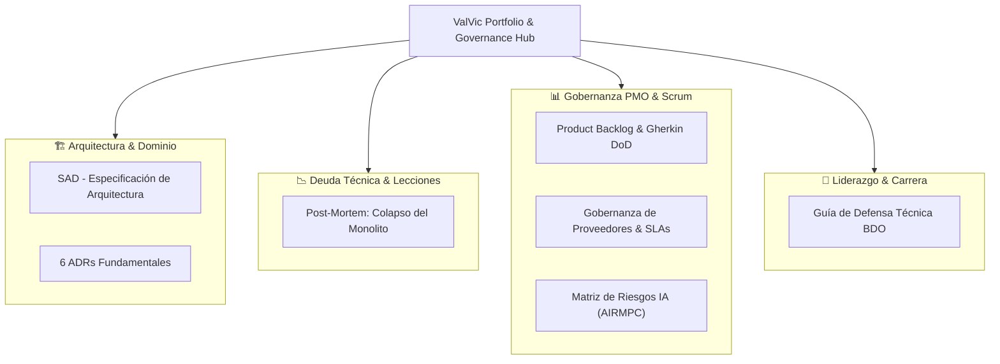

# ValVic — Portafolio de Gestión, Arquitectura y Liderazgo TI

> **Visión Ejecutiva, Constitución Técnica y Gobernanza de Producto.**  
> **Lead Architect & Project Leader:** Víctor Venegas Lindzay  
> **Estándar:** Enterprise Documentation-First (Inspirado en el estándar de ingeniería StockPilot)  

---

## 1. Visión Ejecutiva del Ecosistema ValVic

**ValVic** es una plataforma SaaS multi-tenant diseñada para automatizar el ciclo de vida de atención y agendamiento en clínicas veterinarias, centros de salud y empresas de servicios, combinando mensajería masiva (WhatsApp Cloud API v25.0), agentes de inteligencia artificial (Google ADK) y consistencia transaccional en la nube (Oracle Database 23ai Always Free).

Este repositorio de gestión documenta no sólo la especificación técnica de la plataforma, sino la **gobernanza ágil, los registros de decisiones de arquitectura (ADRs), la gestión de riesgos operacionales y el análisis retrospectivo (Post-Mortem)** tras la refundación del monolito inicial hacia una arquitectura desacoplada y soberana.

---

## 2. Mapa Maestro de la Documentación

---

## 3. Índice Detallado de Documentos

### 🏛️ Arquitectura de Software e Invariantes
* 📘 **[SAD — Documento de Arquitectura de Software](docs/architecture/SAD_SOFTWARE_ARCHITECTURE.md):** Delimitación rigurosa del alcance (In-Scope, Out-of-Scope), invariantes de negocio (Zero Double-Booking, aislamiento multi-tenant), deconstrucción en 4 Bounded Contexts y topología OCI Always Free.
* 📋 **Registros de Decisiones de Arquitectura (ADR):**
  1. [ADR-0001: Desacoplamiento de Ingress con Broker Estándar (Redis)](docs/adr/0001-desacoplamiento-ingress-webhook-skip-locked.md)
  2. [ADR-0002: Paridad Dev/Prod Estricta — Deprecación de SQLite (Twelve-Factor App #10)](docs/adr/0002-dual-database-engine-oracle-23ai-sqlite.md)
  3. [ADR-0003: Adopción de Google ADK vs LangGraph / CrewAI](docs/adr/0003-adopcion-google-adk-vs-langgraph-crewai.md)
  4. [ADR-0004: Modelo de Aislamiento Multi-Tenant por Columna `tenant_id`](docs/adr/0004-aislamiento-multitenant-por-schema-vs-tenant-id.md)
  5. [ADR-0005: Motor de Agenda Anti-Double-Booking con Bloqueo Pesimista](docs/adr/0005-motor-agenda-anti-double-booking-bloqueo-pesimista.md)
  6. [ADR-0006: Deconstrucción del Monolito hacia 3 Microservicios Pragmáticos con Broker Redis](docs/adr/0006-deconstruccion-del-monolito-a-modulos-independientes.md)

### 🔬 Lecciones de Ingeniería y Auditoría de Deuda Técnica
* 🚨 **[Post-Mortem PM-0001: El Colapso del Monolito y la Auditoría de Deuda Técnica](docs/postmortem/0001-analisis-deuda-tecnica-y-colapso-del-monolito.md):** Análisis de causa raíz (5 Whys) sobre el acoplamiento de tareas en el event loop de FastAPI, la trampa de la deuda cognitiva asistida por IA y el imperativo del enfoque *Documentation-First*.

### 📊 Gobernanza Ágil y Gestión de Proyectos (PMO / Scrum)
* 📝 **[Product Backlog & Criterios Gherkin](docs/pmo_scrum/product_backlog.md):** Definición de Listo (DoR), Definición de Hecho (DoD), Epics y User Stories con criterios de aceptación `Dado-Cuando-Entonces`.
* 🤝 **[Gobernanza de Proveedores & SLAs](docs/pmo_scrum/gestion_proveedores_sla.md):** Niveles de servicio para Meta Cloud API, Oracle Cloud y Google Gemini; protocolo de reuniones tácticas/operativas, alertas tempranas y matriz RACI.
* 🛡️ **[Matriz de Gestión de Riesgo en IA (AIRMPC™)](docs/pmo_scrum/matriz_gestion_riesgo_airmpc.md):** Controles deterministas para mitigar alucinaciones clínicas, inyecciones de prompts adversariales y gobernanza del cojín humano ("Botón Dorado").

### 🎯 Preparación Profesional
* 🏆 **[Guía Maestra de Defensa Técnica — Project Leader TI (BDO Chile)](docs/interview_prep/guia_defensa_tecnica_project_leader.md):** Posicionamiento estratégico, narrativa STAR del monolito, puente conceptual hacia el stack Microsoft (Azure, Dataverse, Power BI) y simulación de preguntas de entrevista.
* 📚 **[Glosario Maestro y Guía de Términos Técnicos](docs/interview_prep/glosario_maestro_terminos_tecnicos.md):** Diccionario conceptual de referencia rápida (STAR, MoSCoW, SLAs, Twelve-Factor, etc.).
* 🧭 **[Guía de Lectura de Diagramas de Arquitectura y Matrices PMO](docs/interview_prep/guia_lectura_diagramas_y_matrices.md):** Manual de interpretación y fórmulas de defensa oral para el Modelo C4, Secuencia, FSM, ERD, Matriz RACI, Riesgo AIRMPC, MoSCoW y SLAs.

---

## 4. Estado de Implementación Técnica: As-Is (Código) vs. To-Be (Diseño Documentado)

> [!IMPORTANT]
> **Diferenciación de Ciclo de Vida:**
> * **Código Fuente Actual (As-Is):** Reside en el repositorio principal y refleja el prototipo funcional inicial construido en modo *Code-First* (FastAPI monolítico, colas SQL `sys_webhook_queue`, persistencia dual SQLite/Oracle).
> * **Arquitectura Documentada (To-Be):** Formalizada en este hub bajo el estándar *Documentation-First* tras el Post-Mortem `PM-0001` (3 microservicios, broker Redis, paridad Twelve-Factor estricta). La refactorización en código se ejecuta guiada por estos documentos.

| Componente | Estado en Código (As-Is) | Estado Objetivo Documentado (To-Be) | Notas de Ingeniería |
| :--- | :---: | :---: | :--- |
| **Ingress Webhooks Meta** | 🟡 Cola SQL (`sys_webhook_queue`) | 🎯 Ingress Gateway Stateless + Redis | Reducción de latencia a <15 ms y desacoplamiento de DB |
| **Procesos & Workers** | 🟡 Lifespan en FastAPI (Monolito) | 🎯 Flota de Workers en Contenedores | Aislamiento de fallos y escalabilidad independiente |
| **Agentes Google ADK** | ✅ Operativo en código | 🎯 Worker Dedicado de Inferencia | Control de intents y tools clínicas de agenda |
| **Persistencia de Datos** | 🟡 Dual SQLite / Oracle 23ai | 🎯 Paridad Dev/Prod Estricta (Docker) | Factor X Twelve-Factor: mismo motor en dev, CI y prod |
| **CRM Next.js 15** | ✅ Compilado / Vistas listas | 🎯 Conectado a Core Clinical API | Tablero operacional con control ("Botón Dorado") |
| **Landing & Client Factory** | ✅ Operativo en producción | ✅ `clientes.valvic.cl` / `spotvet.cl` | Motor estático en Astro para generación de sitios |

---
*Documentación consolidada en el marco de la restitución de la soberanía técnica y liderazgo de proyectos de ingeniería de software.*