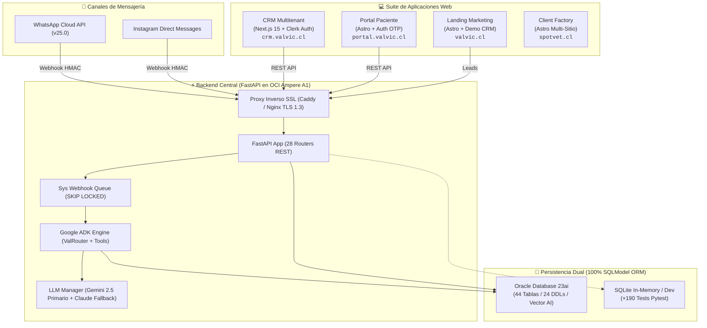
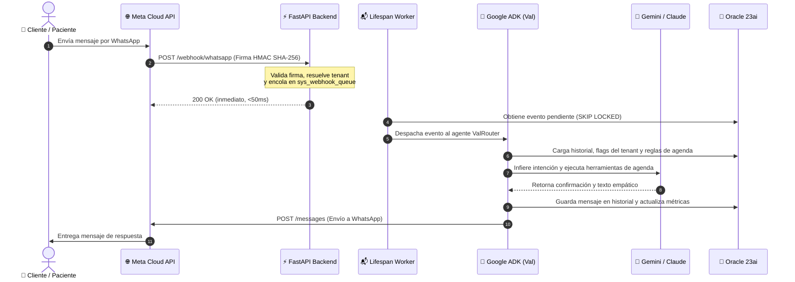

# ValVic — Portafolio de Gestión & Arquitectura de Software

> **Visión Ejecutiva y Técnica del Ecosistema SaaS Multi-Tenant de Automatización Conversacional para Pymes y Clínicas.**  
> *Versión 2.0 — Arquitectura Cloud Native, Google ADK & Dual Database Engine.*

---

## 1. Descripción del Producto y Propuesta de Valor

**ValVic** es una plataforma SaaS multi-tenant diseñada para resolver la pérdida de oportunidades comerciales y la ineficiencia operativa en clínicas veterinarias, centros de salud y empresas de servicios en Chile y Latinoamérica.

El producto unifica en un solo ecosistema:
1. **Captación Outbound Inteligente (Prospector B2B):** Descubre prospectos en Google Maps / Places, audita su presencia digital y genera mensajes de prospección hiper-personalizados para WhatsApp.
2. **Atención & Conversión Inbound con IA (Val - Google ADK):** Atiende clientes 24/7 en WhatsApp e Instagram, maneja consultas frecuentes mediante RAG semántico (AI Vector Search), negocia precios con una escalera de concesiones controlada y agenda citas médicas bloqueando slots en tiempo real.
3. **CRM de Co-pilotaje y Gestión (Next.js 15):** Panel de control para operadores humanos con monitoreo en vivo de chats, pausas en caliente de la IA (cojín humano), control modular mediante el "Botón Dorado", y métricas de atribución y pipeline.
4. **Client Factory (Astro Multi-Tenant):** Motor de generación automatizada de sitios web estáticos de alta velocidad para clientes y clínicas (ej. SpotVet, clientes.valvic.cl), con integración de publicaciones de Instagram, testimonios y reservas directas.

---

## 2. Mapa del Ecosistema y Arquitectura de Componentes

---

## 3. Decisiones Clave de Arquitectura e Innovación Técnica

### A. Desacoplamiento Asíncrono Extremo (Sub-100ms Ingress)
Meta Cloud API exige confirmaciones `200 OK` en menos de 3 segundos para evitar reintentos repetitivos que saturen la infraestructura. ValVic implementa una cola transaccional en base de datos (`sys_webhook_queue`) procesada en segundo plano por workers de ciclo de vida (`lifespan`) de FastAPI con bloqueo optimista `SELECT FOR UPDATE SKIP LOCKED`, liberando el socket HTTP en menos de 50 ms.

### B. Dual Database Engine (100% ORM, 0 SQL Crudo)
* **Producción:** Oracle Database 23ai con capacidades nativas de **AI Vector Search** para recuperar conocimiento clínico y de servicios en milisegundos.
* **Desarrollo y CI/CD:** SQLite local/en memoria que permite ejecutar la suite de +190 tests en segundos sin dependencias externas ni costos de red.
* **Aislamiento Multi-Tenant Estricto:** Toda consulta relacional filtra obligatoriamente por `tenant_id`, garantizando privacidad absoluta de datos entre clínicas.

### C. Failover Inteligente de Modelos de Lenguaje (LLM Manager)
* **Primario:** Google Gemini 2.5 (Flash / Pro) por su latencia ultra-baja y amplia ventana de contexto.
* **Respaldo:** Anthropic Claude (Sonnet / Haiku) con conmutación automática e instantánea ante errores de cuota o timeouts de red.

### D. Infraestructura $0 USD/mes (OCI Always Free)
Toda la plataforma backend, proxies SSL y bases de datos operan sobre la capa gratuita de Oracle Cloud Infrastructure (instancia ARM Ampere de 4 OCPUs, 24 GB RAM y base de datos Autonomous), reduciendo a cero el costo operativo de servidores.

---

## 4. Diagrama de Secuencia: Flujo Conversacional End-to-End

---

## 5. Estado Actual del Sistema y Tareas Pendientes

| Componente | Estado Técnico | Estado Despliegue |
|------------|:--------------:|:-----------------:|
| **FastAPI Backend (28 Routers)** | ✅ 100% Completado | 🟡 Listo para Deploy en OCI |
| **Agentes Google ADK (ValRouter)** | ✅ 100% Operativo | 🟡 Listo para Deploy en OCI |
| **Suite de Tests (+150 tests)** | ✅ 143+ Pasando (Unitarios) | ✅ Integrado en CI/CD |
| **Dual DB (Oracle 23ai + SQLite)** | ✅ 24 DDLs & 44 Modelos | 🟡 DDLs listos para ejecución |
| **CRM Next.js 15** | ✅ Compilación Verificada | 🔴 Deploy en `crm.valvic.cl` pendiente |
| **Client Factory (Astro)** | ✅ Multi-Sitio Operativo | ✅ `clientes.valvic.cl` / `spotvet.cl` |
| **Landing Marketing (Astro)** | ✅ Demo CRM Integrada | ✅ Listo para producción |

### Próximos Pasos Prioritarios (Lanzamiento a Producción):
1. **Puesta en marcha en Oracle Cloud VM:** Configurar Caddy HTTPS y ejecutar los DDLs `01` a `24` en Oracle 23ai.
2. **Despliegue del CRM Next.js:** Conectar el frontend a `api.valvic.cl` y configurar variables de producción de Clerk.
3. **Verificación de Webhooks en Meta Developers:** Homologar el webhook de WhatsApp Business con la URL pública de producción.

---

## 6. Documentación Detallada de Ingeniería

Para explorar a fondo cada aspecto técnico del sistema, consulte los documentos complementarios en la carpeta [`documentacion/`](documentacion/):

1. 📊 **[Colección de Diagramas del Sistema (diagramas_sistema.md)](documentacion/diagramas_sistema.md):** Diagramas C4, flujos de datos, máquinas de estado del CRM y pipelines de generación web.
2. 🏗️ **[Arquitectura de Infraestructura y Red (system_architecture.md)](documentacion/system_architecture.md):** Topología OCI Ampere, seguridad perimetral, AI Vector Search y workers lifespan.
3. 📡 **[Contrato API & Webhooks (api_contract.md)](documentacion/api_contract.md):** Especificación OpenAPI 3.0.3 con schemas de endpoints, webhooks y autenticación JWT.
4. 🗺️ **[Roadmap y Tareas Pendientes (roadmap_y_pendientes.md)](documentacion/roadmap_y_pendientes.md):** Matriz detallada de módulos, bloqueadores de producción y registro de decisiones de arquitectura (ADR).
