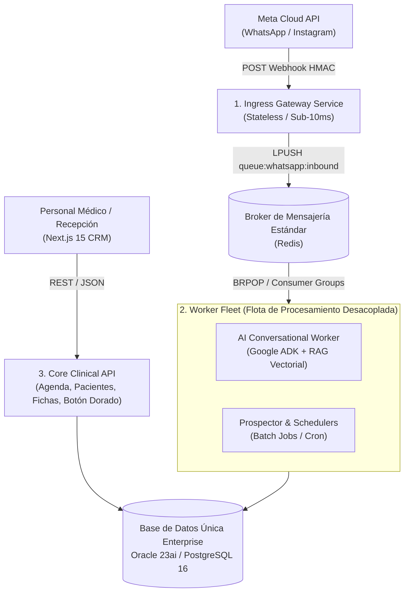

# ADR-0006: Deconstrucción del Monolito hacia 3 Microservicios Pragmáticos con Broker Redis

> **Estado:** Arquitectura Objetivo (To-Be) Aprobada para Refactorización  
> **Fecha:** Mayo 2026 (Consolidado Enterprise To-Be: Noviembre 2026)  
> **Decisores:** Víctor Venegas Lindzay  
> **Área:** Arquitectura de Sistemas / Microservicios / Concurrencia / Redis  

---

## 1. Contexto y Planteamiento del Problema

En la fase inicial de prototipado rápido (As-Is), ValVic se construyó siguiendo un enfoque *Code-First* que agrupó todas las capacidades del negocio en un único proceso monolítico de FastAPI:
* **28 routers REST** y **44 modelos relacionales** (SQLModel/SQLAlchemy).
* **Ingress de Webhooks de Meta (WhatsApp Business):** Endpoints HTTP públicos para recibir mensajes entrantes de pacientes.
* **Agentes de Inteligencia Artificial (Google ADK):** Inferencia con LLMs (Gemini/Claude) y búsqueda vectorial.
* **Procesos Batch de Prospección Comercial en Frío:** Scraping y calificación de leads ejecutados periódicamente.
* **Consumo de Colas:** Bucles continuos en segundo plano ejecutados dentro del ciclo de vida (`lifespan`) del propio servidor web FastAPI.

Como se analizó formalmente en el **Post-Mortem de Ingeniería (`PM-0001`)**, empaquetar flujos con perfiles de carga, latencias y criticidades operacionales tan dispares en un mismo espacio de memoria y event loop generó un **acoplamiento operacional crítico**:
1. Si una inferencia de LLM o un job batch de prospección consumía CPU o bloqueaba el event loop de asyncio, el endpoint de webhooks superaba el SLA estricto de 3 segundos de Meta, provocando que Meta desactivara el webhook y dejara incomunicadas a las clínicas.
2. Si un worker de IA arrojaba una excepción no capturada de memoria, se reiniciaba todo el servidor web, desconectando a los médicos que usaban el CRM en tiempo real.

---

## 2. Opciones Consideradas

| Alternativa | Descripción | Ventajas | Desventajas |
| :--- | :--- | :--- | :--- |
| **Opción A: Mantener el Monolito Centralizado** | Seguir parchando el backend de FastAPI e intentar aislar tareas mediante hilos secundarios (`threading`/`asyncio.create_task`). | Todo el código reside en un solo proyecto; despliegue mediante un único proceso. | **Inviable en producción:** Comparten el mismo espacio de memoria y el GIL de Python. El radio de explosión (*blast radius*) de un fallo en IA o scraping destruye la disponibilidad del CRM y WhatsApp. |
| **Opción B: Microservicios Extremos Distribuidos (Database-per-Service + Kubernetes + gRPC + Sagas)** | Dividir la plataforma en 6 a 8 microservicios independientes, cada uno con su propio clúster, base de datos dedicada y transacciones distribuidas (Saga Pattern). | Aislamiento físico absoluto y autonomía de equipos a gran escala. | **Sobreingeniería y complejidad accidental desmedida:** Para el tamaño actual del equipo, gestionar transacciones distribuidas y consistencia eventual entre agendas y fichas clínicas añade fricción inmanejable; excede los recursos de la capa Always Free / Cloud. |
| **Opción C: 3 Microservicios Pragmáticos con Broker Estándar (Redis) y Base de Datos Enterprise Compartida (Decisión To-Be v2.1 Elegida)** | Deconstruir el sistema en **3 servicios desacoplados en tiempo de ejecución**, comunicados asíncronamente mediante un broker estándar de la industria (**Redis**) y respaldados por un motor relacional unificado con aislamiento multi-tenant por Row-Level Security (RLS). | **Equilibrio óptimo (Pragmatic Microservices):** Aislamiento de fallos absoluto entre Ingress, IA y CRM; cero reinvención de colas artesanales; no requiere Kubernetes ni transacciones distribuidas complejas; despliegue predecible con Docker Compose. | Requiere orquestar 3 contenedores de aplicación más el contenedor de Redis en los pipelines de CI/CD. |

---

## 3. Decisión de Arquitectura: Los 3 Microservicios Pragmáticos

Se aprueba formalmente la **Opción C**, implementando una arquitectura de **3 Microservicios Desacoplados gobernados por eventos en Redis**:

### 3.1 Especificación y Límites de los 3 Servicios:

1. **Microservicio 1 — Ingress Gateway (`valvic-ingress-gateway`):**
   * **Naturaleza:** Servicio ultraliviano y completamente *Stateless*.
   * **Responsabilidad Única:** Recibir el payload HTTP POST de Meta, validar criptográficamente la cabecera `X-Hub-Signature-256`, generar una clave de idempotencia (`SHA256(msg_id)`) y depositar el evento en Redis (`LPUSH`).
   * **SLO de Latencia:** Responde `HTTP 200 OK` en **<10 ms** (p95 < 25 ms).
   * **Resiliencia:** No se conecta a la base de datos relacional ni llama a modelos LLM. Si la base de datos o Gemini están caídos, el Ingress jamás se entera y Meta nunca desactiva el webhook.

2. **Microservicio 2 — Flota de Workers Desacoplados (`valvic-worker-fleet`):**
   * **Naturaleza:** Procesos de fondo que consumen eventos de Redis mediante *Consumer Groups*.
   * **Sub-workers:**
     * `valvic-ai-worker`: Consume mensajes de WhatsApp, ejecuta el razonamiento clínico con Google ADK (Gemini/Claude), consulta disponibilidad e invoca herramientas de agendamiento.
     * `valvic-prospector-worker`: Tareas programadas por cron para enriquecimiento de prospectos y prospección en frío.
   * **Resiliencia & Auto-Recovery:** Si un worker experimenta un fallo de memoria o timeout de API de terceros, Redis retiene el evento y lo reintenta automáticamente con backoff exponencial.

3. **Microservicio 3 — Core Clinical API & CRM (`valvic-core-api`):**
   * **Naturaleza:** Servidor REST de negocio para el CRM médico (Next.js 15).
   * **Responsabilidad:** Gestión de médicos, visualización de historiales clínicos, reportería operativa y control de soberanía en tiempo real (**"Botón Dorado"** para pausar la IA en caliente con latencia <50 ms).

4. **Integración con Broker Estándar (No Reinventar la Rueda):**
   * Se erradican definitivamente las tablas SQL temporales (`sys_webhook_queue`) y el pooling manual con `SELECT FOR UPDATE SKIP LOCKED`.
   * Toda la comunicación asíncrona, colas de reintentos (*Dead-Letter Queues*) y locks temporales de agenda se delegan en **Redis**.

---

## 4. Consecuencias y Compensaciones

### Consecuencias Positivas:
* **Radio de Explosión Cero (Zero Blast Radius):** Un pico de carga en la prospección o un timeout en la API de Google Gemini no impacta la disponibilidad de la recepción de WhatsApp ni la operación de los médicos en el CRM.
* **Escalabilidad Horizontal Independiente:** Si una campaña masiva de marketing genera 500 mensajes por segundo en WhatsApp, se escalan las instancias de `valvic-worker-fleet` sin necesidad de tocar ni sobredimensionar la API del CRM.
* **Mantenibilidad y Paridad Dev/Prod:** Cada servicio cuenta con su propio Dockerfile optimizado. En desarrollo local y CI/CD, todo el ecosistema (los 3 microservicios, Redis y la Base de Datos) se levanta de forma determinista mediante `docker-compose up`.

### Consecuencias Negativas / Limitaciones:
* **Complejidad de Infraestructura:** Se pasa de desplegar un solo contenedor monolítico a orquestar un stack de 4 contenedores (3 servicios + Redis) más la base de datos.
* **Mitigación:** Esta complejidad se estandariza mediante configuración declarativa en Docker Compose y se automatiza en el pipeline de CI/CD de GitHub Actions.

---

## 5. Criterios de Aceptación y Plan de Verificación (Refactorización To-Be)

Para certificar la implementación de este ADR en la Definition of Done (DoD), el equipo deberá superar las siguientes pruebas de aceptación:

* **Prueba de Resiliencia ante Caída de Workers (Gate 1):**
  * Simular la detención total del contenedor `valvic-worker-fleet` mediante `docker stop`.
  * Enviar 100 webhooks concurrentes simulando tráfico de Meta.
  * **Criterio de Éxito:** El Ingress Gateway debe responder con `HTTP 200 OK` al 100% de las peticiones con latencia p95 < 20 ms, y los 100 mensajes deben permanecer en cola en Redis listos para ser procesados al reiniciar el worker.
* **Prueba de Escalabilidad de Procesamiento (Gate 2):**
  * Levantar 3 réplicas del contenedor `valvic-worker-fleet` bajo el mismo *Consumer Group* de Redis.
  * Inyectar 300 eventos simultáneos.
  * **Criterio de Éxito:** El procesamiento debe distribuirse uniformemente entre los 3 workers sin duplicar el envío de mensajes de respuesta a ningún paciente (idempotencia verificada).
