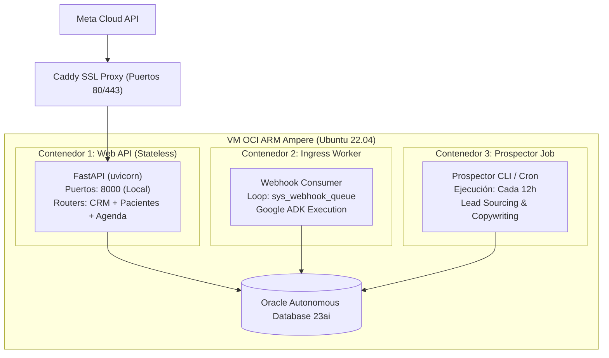

# ADR-0006: Deconstrucción del Monolito hacia Módulos y Servicios Desacoplados

> **Estado:** Aceptado (En Implementación)  
> **Fecha:** Mayo 2026 (Consolidado: Noviembre 2026)  
> **Decisores:** Víctor Venegas Lindzay  
> **Área:** Arquitectura / Ciclo de Vida / Escalabilidad / Microservicios  

---

## 1. Contexto y Planteamiento del Problema

El monorepo de ValVic consolidó en una sola base de código:
* Un backend FastAPI con 28 routers REST y 44 modelos de datos.
* Bucles de fondo ejecutados en el `lifespan` de FastAPI (prospección autónoma y consumo de colas de webhooks).
* Un CRM frontend en Next.js 15.
* Una landing de marketing y un motor de sitios estáticos para clínicas (Client Factory) en Astro.

Como se analizó en el Post-Mortem de Ingeniería (`PM-0001`), empaquetar servicios con perfiles de carga, ciclos de vida y requerimientos de seguridad tan dispares dentro de un único monolito generó acoplamiento operacional, riesgo de caídas cruzadas y una sobrecarga cognitiva insostenible.

---

## 2. Opciones Consideradas

| Alternativa | Descripción | Ventajas | Desventajas |
| :--- | :--- | :--- | :--- |
| **Opción A: Mantener el Monolito Centralizado** | Seguir parchando el backend de FastAPI e intentar aislar mediante hilos internos de Python. | Todo el código reside en un solo lugar; despliegue mediante un único comando `docker-compose up`. | Inviable a mediano plazo: un error fatal en el scraper de prospección tira abajo la atención de urgencias de WhatsApp de las clínicas. |
| **Opción B: Microservicios Puros Distribuidos (Kubernetes + gRPC)** | Dividir inmediatamente la aplicación en 6 microservicios independientes, cada uno con su propio clúster y base de datos. | Aislamiento físico absoluto y escalabilidad independiente. | Complejidad operacional desmedida para el tamaño del equipo; transacciones distribuidas (Sagas); excede los recursos de la capa Always Free de OCI. |
| **Opción C: Monolito Modular Desacoplado con Workers en Contenedores Aislados (Elegida)** | Mantener el código organizado en un único repositorio gobernado pero **separar los procesos de ejecución en tiempo de corrida (Runtime Isolation)** mediante contenedores Docker dedicados: (1) API Web Stateless, (2) Worker Ingress WhatsApp, (3) Job de Prospección Batch. | Aislamiento de fallos y de recursos; no requiere Kubernetes ni Redis; cada proceso tiene su propio ciclo de vida e hilo de ejecución. | Requiere orquestación clara en Docker Compose y delimitación estricta de contratos internos. |

---

## 3. Decisión de Arquitectura

Se decide implementar la **Opción C: Monolito Modular con Aislamiento en Tiempo de Ejecución (Runtime Isolation)**:

1. **Separación de Procesos de Ejecución:**
   * **Contenedor 1 — Web API (`valvic-api`):** Exclusivamente atiende tráfico HTTP REST síncrono para el CRM y los webhooks de Meta. Cero tareas pesadas en segundo plano.
   * **Contenedor 2 — Ingress Worker (`valvic-worker`):** Proceso en segundo plano que consume continuamente `sys_webhook_queue` mediante `SELECT FOR UPDATE SKIP LOCKED` e invoca al agente de IA (Google ADK). Si este worker se reinicia por consumo de memoria de IA, la API web sigue viva y respondiendo `200 OK` a Meta.
   * **Contenedor 3 — Batch de Prospección (`valvic-prospector`):** Contenedor de ejecución por demanda (cron) que realiza prospección comercial en frío sin interferir con las citas clínicas activas.

2. **Gobernanza de Dependencias y Monorepo Limpio:**
   * El código compartido (modelos de datos, utilitarios de cifrado y schemas Pydantic) se consolida en el paquete interno `shared/`.
   * Los frontends (`frontend/crm` y `landing-astro`) operan desacoplados consumiendo exclusivamente la especificación OpenAPI de la API.

---

## 4. Consecuencias y Compensaciones

### Consecuencias Positivas:
* **Tolerancia a Fallos y Alta Disponibilidad:** Una caída o bloqueo en una llamada al modelo de lenguaje (Gemini/Claude) en el worker no afecta la recepción de nuevos mensajes ni la navegación de los médicos en el panel CRM.
* **Control Fino de Recursos:** Se asignan límites estrictos de memoria RAM y CPU en Docker Compose para cada contenedor, evitando que el scraper sature los recursos de la máquina virtual.
* **Preparación para Microservicios Futuros:** Si el volumen de mensajes crece, el `valvic-worker` puede escalarse a múltiples réplicas independientes sin modificar una sola línea de código del servidor web.

### Consecuencias Negativas / Limitaciones:
* **Mayor Complejidad de Despliegue:** Se requiere gestionar múltiples imágenes Docker en lugar de un único ejecutable, lo cual se automatiza mediante scripts de CI/CD estandarizados.

---

## 5. Cumplimiento y Verificación

* **Orquestación en Staging:** `docker compose -f docker-compose.prod.yml up -d` levanta los tres contenedores de forma independiente.
* **Simulación de Falla:** Al matar forzosamente el contenedor `valvic-worker` con `docker kill`, el endpoint de la API sigue respondiendo `200 OK` y acumulando mensajes en cola sin interrupción del servicio.