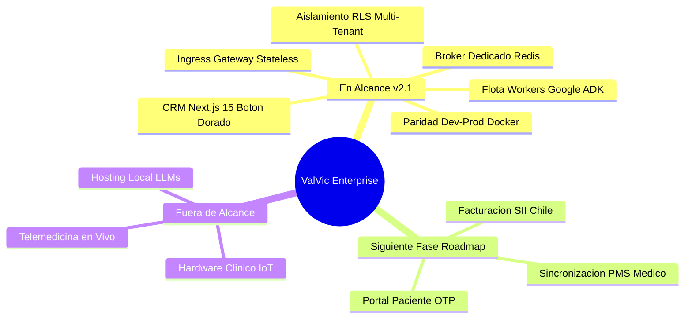
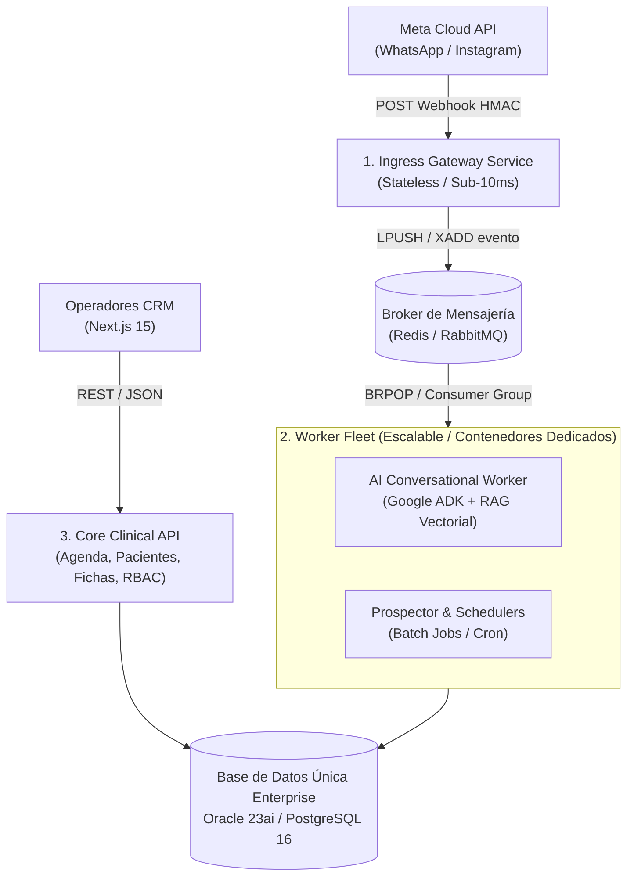
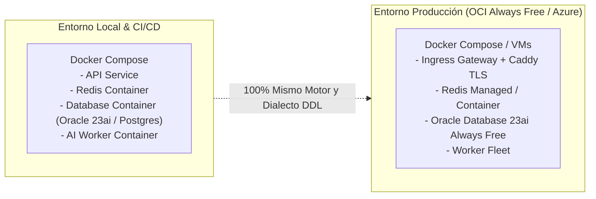

# ValVic — Documento de Arquitectura de Software (SAD)

> **Estado del Documento:** Arquitectura Objetivo (To-Be) Aprobada para Implementación  
> **Estado del Código Base:** Prototipo Inicial As-Is (Monolito Code-First en proceso de refactorización)  
> **Versión:** 2.1.0 — Enterprise Target  
> **Autor Principal:** Víctor Venegas Lindzay — Lead Solutions Architect & Technical Product Manager  
> **Dominio de Negocio:** AI-OS Multi-Tenant y Automatización de Agendas para Clínicas y Prestadores de Salud  
> **Principios Rectores:** Documentation-First + Twelve-Factor App (Paridad Dev/Prod) + DDD  

---

## 1. Contexto de Negocio y Visión del Dominio

**ValVic** es una plataforma tecnológica diseñada para digitalizar, coordinar y automatizar el ciclo de vida del paciente en clínicas veterinarias, centros estéticos y consultorios odontológicos en Chile y Latinoamérica.

### 1.1 El Desafío Operacional de las Clínicas
En el sector salud ambulatorio y veterinario, el 70% de las citas médicas se gestionan a través de canales de mensajería instantánea no estructurados (WhatsApp e Instagram). Las recepcionistas humanas enfrentan un volumen inmanejable de consultas repetitivas (precios, horarios, ubicaciones) y cometen errores humanos de agendamiento (sobrecupos, solapamientos, citas fantasmas). Durante la noche y fines de semana, más del 40% de las intenciones de reserva se pierden por falta de respuesta inmediata.

### 1.2 La Propuesta de Valor Arquitectónica
ValVic introduce un sistema operativo inteligente que desacopla la atención al cliente de la disponibilidad horaria del personal:
1. **Atención Inbound Instantánea:** Un agente conversacional ("Val", Google ADK) que resuelve consultas clínicas frecuentes usando búsqueda semántica vectorial (Oracle 23ai AI Vector Search) y negocia citas médicas respetando las reglas de la clínica.
2. **Consistencia Transaccional Estricta:** Motor de reserva con bloqueo pesimista en base de datos que garantiza **cero sobreventa de horas (Zero Double-Booking)**.
3. **Control Humano Soberano:** Interfaz CRM (Next.js 15) que permite a la recepcionista silenciar la IA con un clic en caliente ("Botón Dorado") para tomar el control de la conversación sin fricción.

### 1.3 Diferenciación Clave: Proyecto Académico (StockPilot) vs. Proyecto Corporativo Real (ValVic)
* **StockPilot (Dominio de Primeros Principios):** Fue concebido como un proyecto demostrativo para exhibir dominio algorítmico profundo: filtros de idempotencia programados desde cero, manejo directo de primitivas de concurrencia (`CountDownLatch`, `AtomicInteger`) y control manual de transacciones.
* **ValVic (SaaS Corporativo de Misión Crítica):** Al ser un producto real para empresas, **está estrictamente prohibido reinventar la rueda**. Todo componente de infraestructura que ya esté resuelto por la industria (colas de mensajes, brokers de eventos, bloqueos distribuidos, schedulers) se delega en herramientas probadas y estandarizadas (**Redis / RabbitMQ / Celery / Docker**) para erradicar la complejidad accidental y enfocar el 100% del esfuerzo en la lógica clínica del negocio.

### 1.4 Estado de Transición: As-Is (Código Actual) vs. To-Be (Arquitectura Objetivo)

En alineación estricta con el principio **Documentation-First**, este documento establece la **Arquitectura Objetivo (To-Be)** que rige la refundación del sistema tras el Post-Mortem de Ingeniería `PM-0001`.

| Dimensión Arquitectónica | Estado Actual en Código (As-Is — Monolito Inicial) | Estado Objetivo Documentado (To-Be — Versión 2.1) | Justificación del Cambio |
| :--- | :--- | :--- | :--- |
| **Ingress & Webhooks** | Encolamiento síncrono en tabla SQL (`sys_webhook_queue`) con worker en `lifespan` de FastAPI | Ingress Gateway Stateless (<15 ms) con broker de mensajería estándar (Redis / RabbitMQ) | Eliminar sobrecarga de I/O en la base de datos y evitar caídas cruzadas por saturación del event loop. |
| **Persistencia & Testing** | Motor dual heterogéneo: SQLite en tests locales y Oracle 23ai en producción | Paridad Dev/Prod absoluta (Factor X): Contenedores Docker idénticos en dev, CI y producción | Eliminar inconsistencias de tipos (`VECTOR`), dialectos DDL y falsos positivos en tests. |
| **Despliegue de Procesos** | Un solo proceso monolítico que corre la API web, tareas batch y scraping | 3 microservicios desacoplados: Ingress Gateway, Worker Fleet y Core Clinical API | Aislar fallos: si un worker de IA o scraping se reinicia, la API web y los webhooks siguen respondiendo. |
| **Bloqueos & Concurrencia** | Diccionario en memoria con `asyncio.Lock()` y `SELECT FOR UPDATE` artesanal | Bloqueo transaccional en BD para reservas + Redis Redlock para tareas distribuidas | Evitar race conditions en escenarios multi-réplica en la nube. |

> [!NOTE]
> El repositorio de código fuente refleja actualmente la versión **As-Is**, la cual sirvió como prototipo funcional inicial para validar el negocio y descubrir los límites del acoplamiento. La presente documentación constituye la especificación formal **To-Be** previa a la ejecución de la refactorización en código.

---

## 2. Delimitación Rigurosa del Alcance (Scope Boundaries)

### 2.1 En Alcance (Core v2.1 Enterprise)
- **Ingress Gateway Stateless:** Endpoint ultraliviano para Meta Graph API v25.0 que valida firmas HMAC-SHA256, encola el payload en Redis en <10 ms y libera el socket HTTP con `200 OK`.
- **Broker de Mensajería Estándar (Redis):** Cola de eventos con soporte nativo de Dead-Letter Queues (DLQ), reintentos con backoff exponencial y candados distribuidos (`Redlock`).
- **Flota de Workers Desacoplados:** Procesos independientes que consumen de Redis, ejecutan inferencias de Google ADK (Gemini 2.5 Flash / Claude) y realizan prospección batch sin tocar el ciclo de vida del servidor web.
- **Paridad Dev/Prod Absoluta (Twelve-Factor App Factor X):** Se erradica SQLite. Tanto en desarrollo local como en CI/CD y producción se ejecuta el mismo motor de base de datos relacional (Oracle 23ai Free o PostgreSQL 16) sobre contenedores Docker.
- **Consola de Control CRM:** Panel en Next.js 15 con monitoreo en vivo de chats y activación del cojín humano ("Botón Dorado").

---

## 3. Invariantes Fundamentales de Negocio

Toda operación del sistema debe respetar de forma inviolable las siguientes reglas:

| # | Invariante | Expresión Lógica / Mecanismo | Justificación de Negocio |
| :-: | :--- | :--- | :--- |
| **I-01** | **Aislamiento Multi-Tenant Absoluto** | Row-Level Security (RLS) nativo en motor BD + inyección de sesión | Una clínica jamás puede leer ni alterar datos de otra. Fuga de datos clínicos viola Ley 19.628 de Protección de la Vida Privada. |
| **I-02** | **Cero Solapamiento de Citas (Zero Double-Booking)** | Restricción Declarativa `UNIQUE/EXCLUDE` en BD + Hold temporal en Redis (TTL 5 min) | Falta grave de servicio citar a dos pacientes a la misma hora con el mismo médico veterinario. |
| **I-03** | **Idempotencia de Mensajería Ingress** | Clave única `idempotency_key = SHA256(msg_id)` con TTL 24h en Redis | Meta Cloud API reintenta peticiones ante latencias de red. Previene enviar respuestas repetidas al paciente. |
| **I-04** | **Cojín Humano en Caliente (Soberanía Operacional)** | `IF tenant.is_ai_paused THEN BYPASS_AGENT()` latencia `<50ms` | Si el médico detecta una urgencia clínica, la IA debe callarse de forma instantánea y ceder el control al humano. |
| **I-05** | **Trazabilidad Inmutable de Cobros y Agendas** | Eventos de estado (`CREATED`, `CONFIRMED`, `CANCELLED`, `REFUNDED`) en append-only log | Auditoría contable y resolución de discrepancias comerciales. |

---

## 4. Arquitectura de 3 Servicios Desacoplados (Microservicios Pragmáticos)

Para erradicar el acoplamiento operacional del monolito inicial, el sistema se divide en tres servicios con ciclos de vida independientes comunicados a través de un broker estándar:

### 4.1 Servicio 1: Ingress Gateway (Frontera de Red)
* **Responsabilidad:** Atender peticiones públicas de Meta, validar criptográficamente la cabecera `X-Hub-Signature-256`, encolar el payload en Redis y retornar `HTTP 200 OK` en menos de 20 ms.
* **Resiliencia:** No depende de base de datos relacional ni de modelos de IA. Si el servidor de IA o la base de datos están lentos, Meta nunca se entera y jamás cancela el webhook.

### 4.2 Servicio 2: Flota de Workers Desacoplados
* **Responsabilidad:** Consumir eventos de la cola de Redis, resolver intenciones del paciente con Google ADK (Gemini/Claude), consultar disponibilidad e invocar herramientas de agenda.
* **Escalabilidad:** Si el tráfico de WhatsApp se triplica, se escalan los contenedores workers sin tocar la API web. Si un worker falla por un timeout de IA, Redis reintenta automáticamente con backoff exponencial.

### 4.3 Servicio 3: Core Clinical API & CRM
* **Responsabilidad:** Servidor de negocio que atiende las peticiones del personal clínico en el panel de control (Next.js 15): gestión de médicos, visualización de historiales médicos (EAV dinámico), control del "Botón Dorado" y métricas de pipeline.

---

## 5. Paridad Dev/Prod y Topología de Infraestructura (Twelve-Factor App Factor X)

* **Eliminación del Anti-Patrón SQLite:** En el pasado, simular Oracle con SQLite generaba discrepancias de sintaxis, errores en tipos `VECTOR` y requería decenas de scripts parches (`fix_all_tests.py`).
* **Estándar Actual:** Se utiliza un contenedor Docker con el mismo motor de producción tanto en desarrollo como en pruebas automatizadas de CI/CD. Los 24 archivos DDL se ejecutan y validan en cada pipeline de integración continua.

---

## 6. Estrategia de Verificación y Testing Automatizado

1. **Tests de Integración con Contenedores Reales:**
   * Pruebas de integración sobre la base de datos real en Docker, asegurando que los tipos `VECTOR`, las claves foráneas compuestas y las secuencias funcionen exactamente igual que en producción.
2. **Pruebas de Estrés de Concurrencia:**
   * Simulación de 50 peticiones simultáneas sobre el endpoint de agendamiento para certificar la invariante I-02 (Zero Double-Booking) con `SELECT FOR UPDATE`.
3. **Pruebas de Resiliencia del Broker:**
   * Simulación de caída del servicio de IA: los mensajes se acumulan de forma segura en Redis y se procesan en cuanto el worker se recupera sin pérdida de un solo lead.