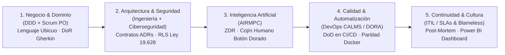
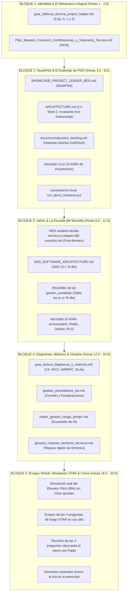

# BDO Chile — Guía Maestra de Defensa Técnica & Metamarco de Trabajo: Project Leader TI

> **Candidato:** Víctor Venegas Lindzay  
> **Cargo:** Project Leader TI (Área TI Exclusiva / DBOP, BDO Chile — Las Condes)  
> **Entrevistador Principal:** Pablo Quezada Estay (Director Ejecutivo & Head de Digital Business Operations Process - DBOP / BPO)  
> **Fecha de Entrevista:** Miércoles  
> **Propósito:** Guía de preparación táctica, narrativa holística unificada, metamarco de gobernanza y simulador de respuestas STAR de alto impacto.

---

## 0. El Lente Evaluador de Pablo Quezada (Head de DBOP / BPO en BDO)

Para responder con máxima asertividad, debes entender **quién te evalúa y qué problemas busca resolver**:

* **Perfil del Evaluador:**
  * **Formación:** Ingeniero Comercial (Universidad Diego Portales) con formación de postgrado en *Advanced Management* en **Stanford University**.
  * **Rol Actual:** Socio / Director Ejecutivo y Head de **Digital Business Operations Process (DBOP / BPO)** en BDO Chile.
  * **Trayectoria de Alto Nivel:**
    * Ex **Country Manager y Miembro del Directorio de Teleperformance Chile** (líder mundial en contact centers, CX y operaciones tercerizadas).
    * Ex **Director de la Unidad de Negocios de BPO en Everis (actual NTT DATA)**.
    * Ex Presidente de la Asociación Chilena de Empresas de Contact Center (ACEC) durante más de 6 años.
    * Asesor de CORFO y el Ministerio de Economía en exportación de servicios globales y outsourcing tecnológico.

* **Los 4 Pilares que Pablo Evaluará en Ti:**
  1. **Eficiencia Operativa & Reducción de Tiempos de Ciclo (*Cycle Times*):** No busca discutir sintaxis de programación; busca a un líder que identifique ineficiencias en procesos manuales de clientes de BDO y lidere su modernización tecnológica.
  2. **Gobernanza de Proveedores & SLAs Contractuales:** En consultoría y BPO, los contratos se ganan o se pierden por cumplimiento de niveles de servicio (disponibilidad 99.9%, latencias, tiempos de respuesta). Necesita saber cómo controlarás a fábricas de software externas.
  3. **Gestión del Cambio & Adopción del Usuario (*Change Management*):** Un sistema perfecto en código fracasa si los auditores, contadores o clientes de BDO se resisten a usarlo.
  4. **Seguridad y Privacidad de Datos en Automatización e IA:** BDO maneja información contable, tributaria y financiera confidencial. Toda solución debe respetar estrictamente la **Ley 19.628 de Protección de Datos Personales** y contar con soberanía operativa.

---

## 1. El Posicionamiento Estratégico (El "Elevator Pitch" de 90 Segundos)

Cuando Pablo te diga: *"Víctor, cuéntanos sobre ti, tu trayectoria y por qué te interesa asumir este rol en BDO"*, tu respuesta debe fluir con seguridad, autenticidad y madurez profesional:

> *"Soy profesional de TI con una trayectoria que combina una sólida base de ciencias de la computación, capacidad de ejecución pragmática y gobernanza ágil de proyectos corporativos.
>
> En la **PUCV cursé hasta cuarto año de Ingeniería Civil Informática**, donde adquirí mi base dura en ciencias de la computación, concurrencia, sistemas operativos y modelado de datos. Posteriormente, por razones económicas y familiares de fuerza mayor, tuve que priorizar mi independencia laboral y pausar la carrera. Lejos de abandonar mi vocación, tomé la decisión práctica y responsable de continuar en **Duoc UC** para culminar mis estudios formalmente como **Analista Programador** en un formato compatible con el trabajo, mientras me especializaba de forma continua mediante **certificaciones internacionales en Scrum Master, Product Owner, DevOps, Ciberseguridad y Gestión de Riesgo en IA**.
>
> Esa experiencia me enseñó a resolver bajo presión, adaptarme a escenarios difíciles y valorar el cumplimiento de metas concretas. Además, mi paso como **Consejero de Carrera en Duoc y Delegado en la PUCV** me entrenó en el manejo de stakeholders complejos, negociación de acuerdos y resolución de conflictos ante autoridades.
>
> En los últimos años lideré como Founder y Technical Product Manager la plataforma **ValVic**, automatizando operaciones y atención clínica mediante IA y mensajería masiva. Allí viví de primera mano los dolores reales del acoplamiento y la deuda técnica, y entendí la importancia de gobernar proveedores bajo contratos estrictos y Criterios de Aceptación (DoD).
>
> Me entusiasma incorporarme a BDO Chile porque el área de DBOP requiere exactamente ese perfil: alguien con el criterio técnico para que un proveedor de software no le venda humo, pero con la visión de negocio y las habilidades blandas para liderar la adopción digital y asegurar los SLAs comprometidos con los clientes."*

---

## 2. El Metamarco Integral de Trabajo (La "Respuesta Holística")

### 2.1 El Concepto: La Tecnología como un Sistema Unificado de Gobernanza
Cuando Pablo Quezada te pregunte:
«Víctor, cuéntanos cómo abordas tú la gestión de un proyecto tecnológico o cómo lideras a un equipo/proveedor»,
no definas los términos uno a uno como conceptos aislados. Demuestra que posees un **metamarco de trabajo integrado** que conecta el negocio con la ingeniería de punta a punta:

### 2.2 Guion de Explicación Verbal del Metamarco (El Guion de 90 Segundos):
> *"Mi forma de liderar proyectos TI no se basa en recetas aisladas, sino en un marco de trabajo integral que conecta el negocio con la ingeniería de punta a punta:
> 
> 1. **Primero, alineación con el negocio (Domain-Driven Design - DDD & Scrum PO):** Me aseguro de hablar el mismo idioma del cliente y delimitar claramente los contextos (*Bounded Contexts*). No acepto especificaciones ambiguas: aplico una estricta *Definition of Ready (DoR)* con criterios en sintaxis Gherkin (`Dado-Cuando-Entonces`) y priorizo con MoSCoW. Si el negocio y los ingenieros no comparten un lenguaje ubicuo, el software nace desalineado y acumula deuda técnica.
> 2. **Segundo, arquitectura por contratos y seguridad por diseño (Ingeniería & Ciberseguridad):** Antes de tirar código, congelo las interfaces (OpenAPI) y formalizo las decisiones estructurales en ADRs. Entiendo que en operaciones corporativas como las de BDO la información es sagrada: todo diseño exige aislamiento multi-tenant nativo a nivel de base de datos (Row-Level Security) y estricto apego a la **Ley 19.628 de Protección de la Vida Privada**.
> 3. **Tercero, Inteligencia Artificial segura con soberanía humana (AIRMPC):** No permito prompts abiertos en procesos críticos. Exijo acuerdos de Cero Retención de Datos (Zero Data Retention - ZDR), validación de esquemas JSON estructurados y un cojín humano en caliente (**'Botón Dorado'**) que permite al operador pausar la IA en milisegundos ante excepciones operacionales.
> 4. **Cuarto, calidad y automatización sin excusas (DevOps bajo pilares CALMS y métricas DORA):** Establezco una *Definition of Done (DoD)* automatizada en pipelines de CI/CD: el código de un proveedor o equipo interno no pasa a producción si no supera pruebas automatizadas de regresión, seguridad y concurrencia bajo paridad absoluta Dev/Prod con Docker. Mido la madurez por métricas DORA (frecuencia de entrega y bajo tiempo de restauración).
> 5. **Y quinto, continuidad operacional, SLAs y cultura de aprendizaje (ITIL, SRE & Sharing):** Diseño para la resiliencia con SLAs contractuales claros (disponibilidad 99.9%, latencia p95) y visibilidad en tiempo real mediante cuadros de mando (puente a Power BI). Y cuando un incidente ocurre, aplico una cultura sin culpa (*Blameless*): documentamos un **Post-Mortem formal de ingeniería**, extraemos las causas raíz y congelamos las lecciones en ADRs para que la organización jamás vuelva a tropezar con la misma piedra.
> 
> **En resumen:** mis certificaciones en Scrum, DevOps, Ciberseguridad y Riesgos de IA no son diplomas para colgar en la pared; son los engranajes con los que garantizo que un proyecto tecnológico entregue valor real, a tiempo y con riesgo operacional controlado."*

---

## 3. La Historia de ValVic: Lección Real de Deuda Técnica, Privacidad y BPO

Uno de tus mayores activos de madurez es saber explicar la evolución de ValVic:

### 3.1 El Producto: BPO y Automatización Inteligente de CX en Salud
ValVic nació para resolver el colapso operacional en clínicas veterinarias y centros de salud, donde el 70% de las citas se gestionan por canales no estructurados (WhatsApp e Instagram). Diseñaste una solución BPO que automatizó la atención 24/7 y la negociación de citas, integrando agentes conversacionales (Google ADK) y sincronización con el CRM.

### 3.2 El Quiebre: Acoplamiento Técnico y Riesgo Crítico de Privacidad de Datos
Al inicio se construyó un prototipo funcional rápido (*Code-First*) en un backend FastAPI monolítico. Con el tiempo se identificaron dos alertas críticas:
1. **Acoplamiento Operacional en el Event Loop:** Las tareas pesadas de fondo (scraping, inferencia LLM) compartían el mismo proceso de la API web, arriesgando superar el SLA de 3 segundos de Meta y provocar la desactivación del webhook.
2. **Riesgo de Compliance y Privacidad de Datos:** Al auditar la arquitectura, detectaste que utilizar APIs de IA convencionales o de consumo masivo conllevaba el riesgo inaceptable de que los proveedores utilizaran las conversaciones clínicas de pacientes para re-entrenamiento de sus modelos, violando el secreto profesional y la **Ley 19.628**. Además, la base de datos tenía persistencia dual (SQLite local vs Oracle producción), lo que impedía probar bloqueos pesimistas reales.

### 3.3 La Decisión Ejecutiva de Liderazgo: Post-Mortem y Documentation-First
En lugar de seguir parchando el código, tomaste la decisión de un líder senior:
* **Frenar el desarrollo desordenado en código.**
* **Liderar un Post-Mortem formal de ingeniería (`PM-0001`).**
* **Adoptar el estándar *Documentation-First*:** Refundar el sistema documentando formalmente la **Arquitectura Objetivo (To-Be)** antes de volver a escribir código:
  * **3 Microservicios Pragmáticos Desacoplados:** Ingress Gateway Stateless (<10 ms), Flota de Workers independientes y Core Clinical API.
  * **Broker Estándar (Redis):** Cero reinvención de la rueda; colas de reintentos y candados distribuidos nativos.
  * **Paridad Dev/Prod Estricta (Twelve-Factor #10):** Eliminación definitiva de SQLite; contenedores Docker idénticos en dev, CI y producción.
  * **Acuerdos Enterprise de IA:** Exigir contratos de Cero Retención de Datos (*Zero Data Retention*) y ejecutar el RAG sobre la propia base de datos corporativa.

### 3.4 Cómo Explicar con Aplomo: As-Is (Código) vs. To-Be (Documentación)
Si te preguntan si toda esta arquitectura ya está programada en el repositorio de ValVic:
> *"El código fuente actual refleja el estado **As-Is** de la plataforma: el prototipo inicial funcional construido en modo Code-First. Fue precisamente ese prototipo en producción el que me permitió validar el modelo comercial y descubrir en la práctica los límites del acoplamiento y los riesgos de privacidad de datos.
>
> La documentación que ven hoy (el SAD v2.1 y los 6 ADRs) constituye la **Arquitectura Objetivo (To-Be)**. Como Project Leader, apliqué la disciplina **Documentation-First**: congelamos los planos, los contratos de datos y los niveles de servicio antes de autorizar la refactorización. Esa misma disciplina es la que aplico en BDO para asegurar que ningún proveedor empiece a tirar código sin una arquitectura aprobada."*

---

## 4. El Showcase de StockPilot: El Estándar de Rigor PMO (5 Minutos)

Si en la entrevista te ofrecen compartir pantalla o te piden mostrar evidencia de tu trabajo:

### 4.1 Preparación Técnica Previa:
* Doble pantalla: En tu pantalla secundaria ten abierta esta guía y los documentos.
* En tu pantalla principal: Ejecuta `run_demo_frontend.ps1` en la raíz de StockPilot para tener el Dashboard en `http://localhost:5173`.
* Ten abiertas pestañas en GitHub con:
  * [README.md de StockPilot](https://github.com/vivenegasl/stockpilot-b2b) (Timeline y métricas).
  * [ARCHITECTURE.md](https://github.com/vivenegasl/stockpilot-b2b/blob/main/docs/architecture/ARCHITECTURE.md) (C4 Nivel 2 y Mindmap interactivo).
  * [product_backlog.md](https://github.com/vivenegasl/stockpilot-b2b/blob/main/docs/scrum/product_backlog.md) (Historias de usuario con Gherkin).
  * [Directorio de ADRs](https://github.com/vivenegasl/stockpilot-b2b/tree/main/docs/adr) (10 decisiones formales).

### 4.2 El Guion Minuto a Minuto:
* **Minuto 1 — El Dolor de Negocio e Invariantes:**  
  > *"StockPilot es una plataforma B2B para distribución mayorista de componentes industriales de alta demanda (como PLCs Siemens). En este sector, vender stock inexistente (sobreventa) paraliza plantas mineras y acarrea multas contractuales severas. Por eso definí como ley matemática del software: `available_qty = total_qty - reserved_qty >= 0`. Toda la arquitectura se subordinó a garantizar esa regla."*
* **Minuto 2 — Gobernanza Scrum y Criterios Gherkin:**  
  *(Muestras `docs/scrum/product_backlog.md`)*  
  > *"Estructuré el proyecto en 4 Sprints formales. Como Product Owner certificado, cada historia de usuario cuenta con al menos dos escenarios en formato **Gherkin (`Dado-Cuando-Entonces`)**: uno de camino feliz y uno de borde. Cada Sprint tiene su acta formal de Review y Retrospective con métricas de velocidad y compromisos de mejora continua."*
* **Minuto 3 — Control de Proveedores mediante ADRs:**  
  *(Muestras la carpeta `docs/adr/`)*  
  > *"Para evitar la deuda técnica que suele dejar el outsourcing descuidado, formalicé **10 Registros de Decisiones de Arquitectura (ADRs)**. Aquí se justifica por qué elegimos un Monolito Modular en vez de microservicios prematuros, cómo usamos bloqueo pesimista `SELECT ... FOR UPDATE` para evitar race conditions y cómo implementamos un filtro de idempotencia HTTP con ventana de 24 horas para evitar órdenes duplicadas ante reintentos de red."*
* **Minuto 4 — La Definition of Done (DoD) Verificada con Estrés:**  
  *(Muestras `OrderReservationConcurrencyTest.java`)*  
  > *"Mi criterio de aceptación con un proveedor no es su palabra. Exijo pruebas empíricas automatizadas: diseñé un test de concurrencia destructivo donde **50 hilos simultáneos compiten por la última unidad en stock**. La prueba demuestra matemáticamente que exactamente 1 hilo reserva con éxito y los otros 49 son rechazados con HTTP 409 Conflict con cero sobreventa."*
* **Minuto 5 — Dashboard Operacional y Puente a Power BI:**  
  *(Muestras la aplicación corriendo en `http://localhost:5173`)*  
  > *"Finalmente, los operadores y gerentes necesitan visibilidad en tiempo real. Construí esta consola en React 19 con estética Dark Luxury que grafica el inventario segregado por bodega, la mesa de órdenes transaccionales y la telemetría en vivo desde Prometheus. Este cuadro de mando representa exactamente los modelos analíticos y KPIs operacionales que se integran en **Power BI** en el ecosistema Microsoft de BDO."*

---

## 5. El Puente Conceptual hacia el Ecosistema Microsoft de BDO

En la oferta de BDO se mencionan **Microsoft 365, Azure, Power BI, Dataverse y Power Automate**. Tu fortaleza es demostrar que **entiendes la arquitectura subyacente y sabes cómo gobernar estas herramientas corporativas**:

| Concepto en tu Experiencia (Linux / Docker / SQL) | Equivalente en Microsoft BDO | Cómo Defenderlo en la Entrevista |
| :--- | :--- | :--- |
| **Modelado de Datos Relacional & SQLModel** | **Microsoft Dataverse (Common Data Model - CDM)** | *"Dataverse es esencialmente un repositorio relacional unificado orientado a entidades de negocio con seguridad basada en roles (RBAC). Modelar entidades, relaciones 1:N, N:M y reglas de validación en Dataverse sigue exactamente los mismos principios de integridad referencial y normalización que aplico en SQL."* |
| **Reportería Analítica & Métricas Dimensionales** | **Power BI (Modelos Semánticos & DAX)** | *"Un buen dashboard en Power BI depende en un 80% de cómo está estructurado el modelo de datos (esquema en estrella con tablas de hechos y dimensiones). Mi experiencia diseñando tablas analíticas y telemetría en Prometheus me permite estructurar modelos de Power BI limpios, traduciendo datos de negocio en KPIs estratégicos para los socios de BDO."* |
| **Infraestructura Cloud (OCI / Linux / Docker)** | **Microsoft Azure (App Services, VMs, Key Vault)** | *"Los fundamentos de computación en la nube son universales: subredes virtuales, seguridad perimetral, gestión centralizada de secretos y monitoreo. En OCI y Docker gestiono VMs, proxies SSL y contenedores aislados; en Azure los conceptos homólogos son Azure App Services, Azure Virtual Machines, Azure Key Vault y Azure SQL."* |
| **Webhooks y Workers Asíncronos Desacoplados** | **Power Automate / Azure Logic Apps** | *"Para automatizar rutinas operacionales y reportes de gestión entre Microsoft 365 (Teams, Outlook, SharePoint) y Dataverse, Power Automate y Logic Apps permiten orquestar flujos basados en eventos con conectores estándar, reduciendo el trabajo manual repetitivo de los equipos de backoffice de BDO."* |

---

## 6. Banco de Preguntas STAR Integradas (El Simulador de Fuego)

### Pregunta 1: *"¿Cómo gestionas a un proveedor tecnológico que muestra retrasos o entrega código de baja calidad?"*
> * **Situación:** En proyectos corporativos de integración, las software factories externas frecuentemente presentan desvíos en plazos o entregan módulos con fallas en pruebas de estrés.
> * **Tarea:** Asegurar el cumplimiento del cronograma contractual sin comprometer la estabilidad operativa ni incurrir en sobrecostos para la empresa.
> * **Acción:** *"Aplico una gobernanza proactiva basada en tres instrumentos:  
>   1. **Comités Operativos Semanales con Burndown Chart:** Revisamos el avance de las historias de usuario y detectamos bloqueadores tempranos. Si hay una dependencia interna de BDO (accesos, definiciones), la resuelvo de inmediato.  
>   2. **Definition of Done (DoD) Automatizada en CI/CD:** El proveedor no me entrega 'archivos zip'; entrega ramas en Git sujetas a un pipeline automatizado. Si el código no alcanza el 85% de cobertura de pruebas o falla los tests de estrés de concurrencia, el entregable se rechaza automáticamente.  
>   3. **Gestión de Alcance con MoSCoW:** Si el retraso es crítico y pone en riesgo una fecha regulatoria inamovible, negocio la despriorización temporal de funcionalidades 'Should Have' o 'Could Have', manteniendo intactos los 'Must Have'.  
>   4. **Aplicación Contractual de SLAs:** Si el incumplimiento persiste, aplico la matriz de SLAs con penalizaciones contractuales y exijo la incorporación de ingenieros Senior de refuerzo sin costo adicional para BDO."*
> * **Resultado:** Se entrega el hito en la fecha comprometida con calidad certificada y sin deuda técnica acumulada.

---

### Pregunta 2: *"¿Cómo decides si un proceso manual de clientes de BDO debe automatizarse con RPA, software a medida o Inteligencia Artificial?"*
> * **Situación:** En el área de DBOP (BPO), los clientes de BDO solicitan digitalizar y automatizar múltiples tareas operativas (conciliaciones bancarias, procesamiento de facturas, atención de consultas).
> * **Tarea:** Definir la solución tecnológica más costo-eficiente, segura y mantenible sin caer en sobreingeniería ni en modas tecnológicas.
> * **Acción:** *"Aplico una matriz de decisión basada en tres criterios objetivos:  
>   1. **Reglas Deterministas vs. Juicio Probabilístico:** Si el proceso tiene reglas de negocio 100% lógicas y estructuradas (ej. validar RUT, cruzar montos de factura con órdenes de compra), **está prohibido usar IA generativa**. Se implementa una automatización determinista mediante scripts, APIs o herramientas RPA (Power Automate), garantizando cero alucinaciones y costo operativo casi nulo.  
>   2. **Datos No Estructurados y Lenguaje Natural:** Si el proceso involucra interpretar correos entrantes, clasificar intenciones de clientes o extraer datos de contratos escaneados heterogéneos, se justifica la **Inteligencia Artificial**, pero bajo esquemas JSON estrictos y con un cojín humano (*Human-in-the-Loop*) para casos con score de confianza menor al 90%.  
>   3. **Volumen y Retorno de Inversión (ROI):** Calculo el costo de desarrollo y licencias frente a las horas-hombre ahorradas. Si el proceso se ejecuta una vez al mes y tarda 20 minutos, automatizarlo añade complejidad accidental innecesaria; se optimiza el procedimiento manual."*
> * **Resultado:** Soluciones robustas, predecibles y con un retorno de inversión claro para los clientes de BDO.

---

### Pregunta 3: *"¿Cómo manejas la resistencia al cambio cuando implementas un nuevo sistema y el personal se resiste a usarlo?"*
> * **Situación:** Al desplegar una nueva plataforma de gestión o un CRM operativo, los usuarios acostumbrados a sus planillas de Excel y métodos tradicionales muestran reticencia y continúan operando por fuera del sistema.
> * **Tarea:** Lograr una tasa de adopción activa superior al 85% en las primeras 4 semanas post-lanzamiento, minimizando la fricción operativa.
> * **Acción:** *"Mi experiencia como Consejero de Carrera en Duoc UC me enseñó que la resistencia nunca es por capricho; es por miedo a perder control o por no entender el beneficio directo. Aplico una estrategia en tres pilares:  
>   1. **Involucrar a los 'Champions' desde el Diseño:** Identifico a los líderes informales de cada departamento y los sumo a las sesiones de refinamiento y pruebas UAT. Si ellos co-diseñan la solución, se convierten en los principales defensores frente a sus compañeros.  
>   2. **Capacitaciones Prácticas y Cápsulas de Microaprendizaje:** Elimino los manuales de 100 páginas que nadie lee. Creo cápsulas en video de 3 minutos y guías paso a paso de una sola carilla enfocadas en 'cómo resolver tu tarea diaria en la mitad de clics'.  
>   3. **Métricas de Adopción Temprana:** Monitoreo la actividad de usuarios en los logs y paneles de Power BI. Si un área presenta bajo uso, me reúno personalmente con ellos para entender sus dolores de usabilidad y aplicar ajustes rápidos en los sprints siguientes."*
> * **Resultado:** Transición ordenada, alta satisfacción de usuario y erradicación de los sistemas en la sombra (*Shadow IT*).

---

### Pregunta 4: *"¿Cómo garantizas que la Inteligencia Artificial no exponga información confidencial de clientes corporativos de BDO?"*
> * **Situación:** Clientes de BDO exigen garantías absolutas de que sus datos contables, nóminas y estrategias financieras no sean filtrados ni utilizados indebidamente al integrar capacidades de IA.
> * **Tarea:** Diseñar un marco de ciberseguridad y gobernanza de IA que cumpla con la Ley 19.628 de Protección de la Vida Privada y estándares corporativos internacionales.
> * **Acción:** *"Aplico el marco **AIRMPC (AI Risk Management)** estructurado en tres barreras infranqueables:  
>   1. **Acuerdos Contractuales de Cero Retención (Zero Data Retention - ZDR):** Solo se utilizan endpoints empresariales de Azure OpenAI o Google Cloud donde el contrato estipula explícitamente que los datos del cliente jamás se almacenan ni se utilizan para entrenar los modelos públicos de la compañía proveedora.  
>   2. **Sanitización Previa y Anonimización (DLP):** Antes de que un prompt viaje al modelo, un middleware de inspección de datos enmascara automáticamente información sensible (RUTs, nombres, montos confidenciales, números de cuenta).  
>   3. **Aislamiento Multi-Tenant en la Base de Datos:** Los embeddings vectoriales y la información contextual residen en la base de datos relacional protegida por Row-Level Security (RLS) inyectando el `tenant_id` obligatorio. El modelo de IA jamás tiene acceso a datos de dos clientes simultáneamente."*
> * **Resultado:** Adopción segura de inteligencia artificial con blindaje legal, cumplimiento normativo y confianza total de los socios y clientes de BDO.

---

## 7. Preguntas Estratégicas que TÚ Debes Hacer al Cierre

Hacer preguntas inteligentes demuestra visión estratégica y confirma que estás pensando como el líder que BDO necesita:

1. *"Don Pablo, considerando su amplia trayectoria en optimización de operaciones y BPO, ¿cuáles son hoy los mayores cuellos de botella operacionales o de procesos que la unidad de DBOP busca resolver en los próximos 6 meses?"*
2. *"En la gobernanza de las soluciones tecnológicas que BDO entrega a sus clientes, ¿cuál es el balance actual entre desarrollo interno y software factories externas, y qué desafíos han experimentado en el control de calidad de esas entregas?"*
3. *"En cuanto a la adopción de inteligencia artificial y automatización en los procesos de backoffice, ¿cuentan ya con un comité formal de gobernanza y seguridad de datos, o uno de los objetivos de este rol será estructurar esa política?"*

---

## 8. Ruta Canónica de Lectura y Estudio (El Sprint de 20 Horas)

Para aprovechar al máximo tus horas de preparación previa a la entrevista, sigue esta secuencia cronológica de lectura:

### Resumen de Metas de Aprendizaje por Bloque:
* **Bloque 1 (Horas 1 a 3.5):** Internalizar la narrativa de tu formación dual (PUCV + Duoc) y el **Metamarco Integral de Trabajo**. Saber responder fluidamente de dónde vienes y cómo articulas tus certificaciones.
* **Bloque 2 (Horas 3.5 a 8.0):** Dominar la demostración de StockPilot en 5 minutos, entender por qué cada uno de los 10 ADRs protege el negocio y tener listo el frontend en `http://localhost:5173`.
* **Bloque 3 (Horas 8.0 a 12.5):** Dominar el Post-Mortem de ValVic: explicar con soltura la lección de deuda técnica, los riesgos de privacidad que te llevaron a frenar el código y el diseño To-Be desacoplado con Redis.
* **Bloque 4 (Horas 12.5 a 16.5):** Repasar la lectura de diagramas C4 y las matrices PMO (RACI, MoSCoW, AIRMPC, SLAs). Conectar métricas duras (p95, 99.9%, RTO/RPO).
* **Bloque 5 (Horas 16.5 a 20.0):** Ensayar en voz alta, calibrar el tono corporativo, revisar tu entorno de videollamada y descansar adecuadamente.
