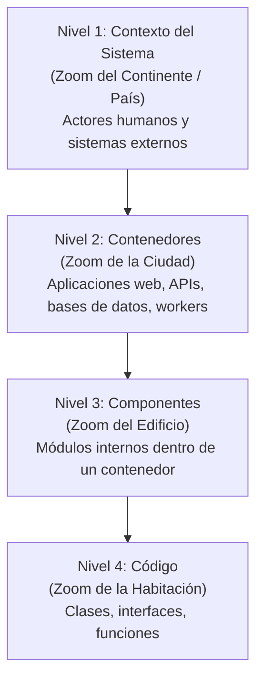
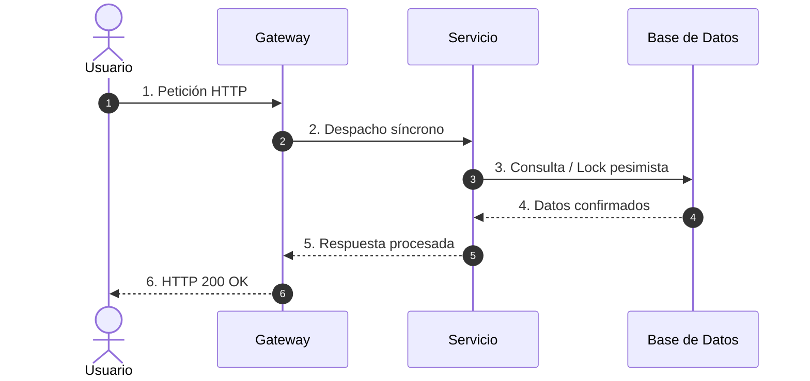
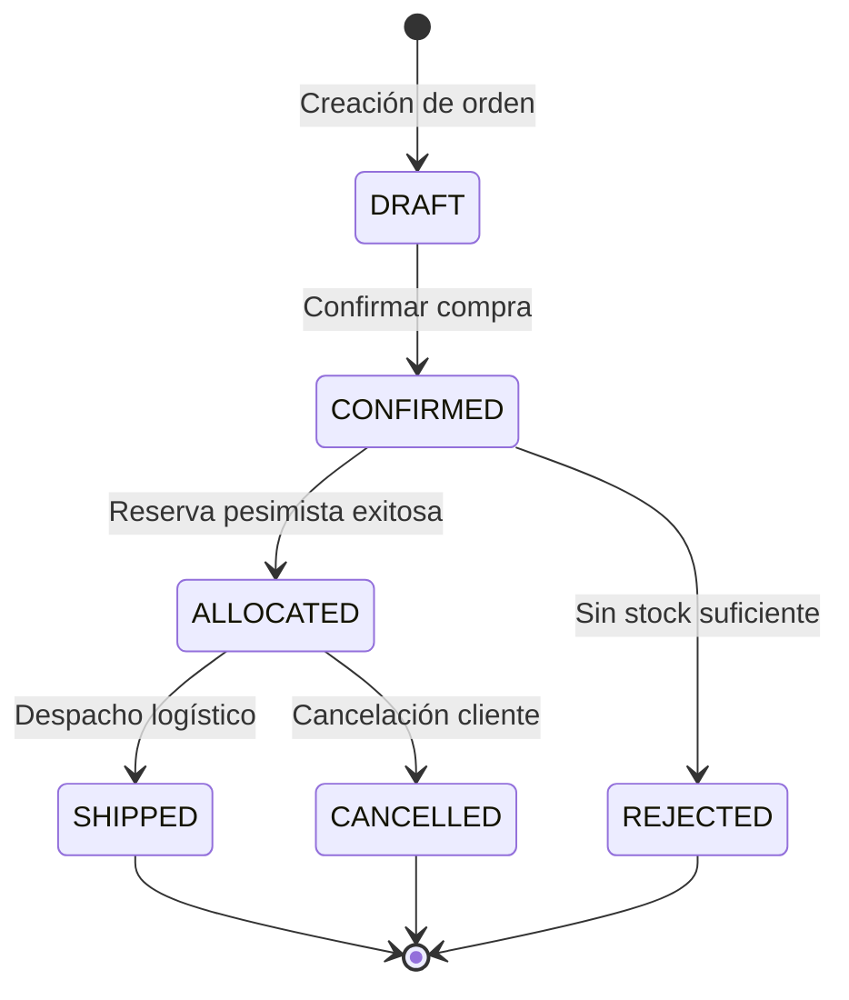
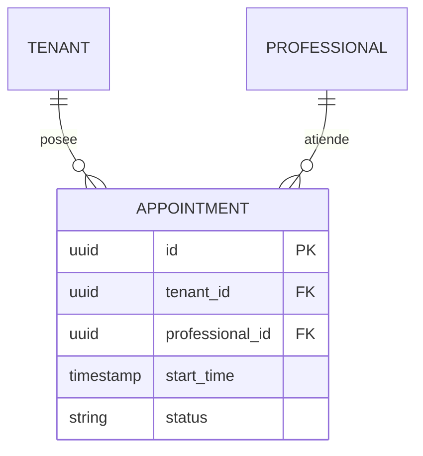
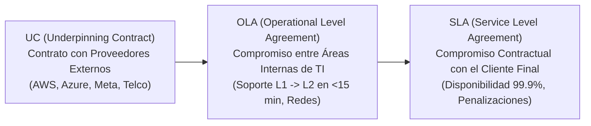
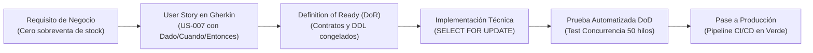

# Guía Maestra de Lectura, Análisis y Defensa: Diagramas de Arquitectura y Matrices PMO

> **Destinatario:** Víctor Venegas Lindzay  
> **Objetivo:** Dominio conceptual, interpretación visual y narrativa oral para la entrevista técnica de **Project Leader TI** en BDO Chile (con Pablo Quezada Estay).  
> **Estándar:** Enterprise Architecture (C4 Model, UML) & IT Governance (Scrum, RACI, AIRMPC, SLAs).

---

## 🧭 Introducción: La Mentalidad del Project Leader ante un Artefacto Visual

Un desarrollador junior mira un diagrama y describe la sintaxis: *"aquí hay una flecha que va del controller al service y llama a la base de datos"*.  
Un **Project Leader TI** mira el mismo diagrama y explica **el flujo de valor, los contratos de interfaz, las invariantes de negocio y los puntos de falla**:

```
FÓRMULA UNIVERSAL DE 3 PASOS PARA EXPLICAR CUALQUIER DIAGRAMA:
1. PROPÓSITO DE NEGOCIO: ¿Qué dolor del cliente o de la operación resuelve esta estructura?
2. FLUJO PRINCIPAL & COMPONENTES: ¿Cómo viaja la información y quién es responsable de procesarla?
3. PUNTOS DE CONTROL & RESILIENCIA: ¿Dónde están los cuellos de botella y qué pasa si un componente falla?
```

---

# BLOQUE 1: Diagramas de Arquitectura de Software

---

### 1.1 El Modelo C4 (Contexto, Contenedores, Componentes, Código)

Creado por Simon Brown, el **Modelo C4** es a la arquitectura de software lo que **Google Maps** es a la navegación geográfica: permite hacer zoom progresivo sin perder la perspectiva.



#### ¿Qué es cada nivel y cómo se lee?

| Nivel C4 | ¿Qué muestra? | Audiencia Típica | Elementos Clave |
| :--- | :--- | :--- | :--- |
| **Nivel 1: Contexto** | La caja negra del sistema, los usuarios que lo usan y los sistemas externos con los que se comunica. | Gerencia General, Clientes, Stakeholders de negocio. | Personas (Comprador, Médico), Sistema Central, APIs de terceros (Meta, SII, Azure). |
| **Nivel 2: Contenedores** | Las unidades de despliegue físico/lógico independientes (procesos ejecutables). | **Project Leaders**, Arquitectos, DevOps, Proveedores TI. | SPA React, Reverse Proxy Nginx, API Spring Boot, Contenedor Redis, DB PostgreSQL. |
| **Nivel 3: Componentes** | Cómo está dividido internamente un contenedor en módulos de software. | Líderes Técnicos, Desarrolladores Senior. | Módulo `catalog`, `ordering`, `inventory`, `audit`, controladores, filtros. |
| **Nivel 4: Código** | Diagramas de clases o código fuente. (Casi nunca se muestra en gestión). | Desarrolladores. | Métodos, atributos, interfaces `@Immutable`. |

#### 🗣️ Guion de Lectura Oral para el C4 Nivel 2 de StockPilot:
> *"Este diagrama representa el **Nivel 2 (Contenedores)** de StockPilot. Se lee de arriba hacia abajo siguiendo las capas de la solución:*
> 1. *En la **Capa de Actores**, tenemos al comprador B2B y al operador logístico.*
> 2. *En la **Capa Perimetral**, un Nginx actúa como reverse proxy gestionando TLS 1.3, rate limiting y sirviendo la SPA de React 19.*
> 3. *En la **Capa de Aplicación**, opera nuestro backend Spring Boot 3.4 como un monolito modular: la petición pasa primero por el filtro de idempotencia para evitar solicitudes duplicadas y luego se despacha al módulo de órdenes.*
> 4. *En la **Capa de Persistencia**, los módulos se comunican con PostgreSQL 16 mediante HikariCP, donde las reservas aplican bloqueos pesimistas `SELECT ... FOR UPDATE` para evitar sobreventa.*
> 5. *Lateralmente, la telemetría se expone hacia Prometheus para alimentar el cuadro de mando operacional."*

---

### 1.2 Diagramas de Secuencia (Sequence Diagrams)

Modelan la **interacción temporal** entre componentes para completar una transacción de negocio.



#### Reglas de Oro de Interpretación:
1. **El Eje del Tiempo:** Transcurre **estrictamente de arriba hacia abajo**. Lo que está más arriba ocurrió primero.
2. **Las Líneas de Vida (Lifelines):** Son las líneas verticales discontinuas que bajan de cada participante. Representan la existencia de ese componente en el tiempo.
3. **Cajas de Activación:** Los rectángulos verticales sobre la línea de vida indican que el componente está ejecutando código en ese instante (consumiendo CPU/hilos).
4. **Tipos de Flechas:**
   * Flecha sólida con punta rellena (`->>`): **Llamada Síncrona** (el emisor se bloquea y espera respuesta).
   * Flecha discontinua (`-->>`): **Retorno de datos** (respuesta a una llamada síncrona).
   * Flecha con punta abierta o asíncrona (`--)`): **Mensaje Asíncrono** ("fire and forget", el emisor envía y sigue sin esperar).
5. **Fragmentos Combinados (Cajas lógicas):**
   * `alt / else`: Condición alternativa (un `if/else`).
   * `opt`: Condición opcional (un `if` simple).
   * `loop`: Bucle repetitivo.

#### 🗣️ Guion de Lectura Oral para la Secuencia de Webhook en ValVic:
> *"Al analizar este diagrama de secuencia, el flujo crítico de diseño se ubica en el paso 2: en lugar de que el Ingress Gateway espere a que el agente de IA complete su inferencia (lo que tardaría 3 segundos y violaría el SLA de Meta), el Gateway deposita el mensaje en Redis y responde de inmediato un HTTP 200 OK en 10 milisegundos. La línea de vida del worker de IA procesa la consulta de forma asíncrona en segundo plano sin bloquear el socket del cliente."*

---

### 1.3 Diagramas de Estados (State Machine / FSM)

Modelan los **estados válidos por los que puede transitar una entidad de negocio** a lo largo de su ciclo de vida y los eventos que provocan esas transiciones.



#### Reglas de Oro de Interpretación:
1. **Estado Inicial `[*]`:** El punto de entrada o nacimiento de la entidad.
2. **Estados (Cajas):** Condiciones en las que la entidad permanece en reposo (`DRAFT`, `CONFIRMED`, `ALLOCATED`).
3. **Transiciones (Flechas):** Vías legales de cambio. **Si no hay una flecha entre dos estados, la transición es una violación de las reglas de negocio.**
4. **Eventos y Guardas:** Las etiquetas sobre las flechas indican qué provocó el cambio (evento) y qué condición matemática debía cumplirse (guarda).

#### 🗣️ Guion de Lectura Oral para la FSM de StockPilot:
> *"Esta máquina de estados finita gobierna el ciclo de vida de la orden de compra. La regla de negocio fundamental es que una orden jamás puede saltar directamente de `DRAFT` a `SHIPPED`. Debe transitar obligatoriamente por `ALLOCATED`, que es el único estado donde se adquiere el bloqueo pesimista en base de datos. Si el cliente cancela, el estado `CANCELLED` dispara un evento compensatorio que decrementa las reservas y restituye el stock disponible."*

---

### 1.4 Diagramas Entidad-Relación (ERD) Físicos

Modelan la **estructura de almacenamiento, integridad referencial y cardinalidad** de la base de datos.



#### Símbolos de Cardinalidad (Patas de Gallo / Crow's Foot):

| Símbolo | Notación | Significado en Negocio | Ejemplo |
| :---: | :---: | :--- | :--- |
| `||--||` | Uno a Uno estricto | Una entidad se relaciona exactamente con una y solo una. | Un usuario tiene un único perfil de auditoría. |
| `||--o{` | Uno a Muchos opcional | Un padre puede tener de 0 a muchos hijos. | Un médico puede tener 0 o muchas citas agendadas. |
| `||--|{` | Uno a Muchos obligatorio | Un padre debe tener al menos 1 hijo. | Una orden de compra debe contener al menos 1 ítem. |
| `>o--o<` | Muchos a Muchos | Relación N:M (requiere tabla intermedia asociativa). | Productos y Categorías. |

#### 🗣️ Guion de Lectura Oral:
> *"En este ERD, la relación fundamental es el aislamiento multi-tenant: cada tabla de negocio posee una clave foránea `tenant_id` que se relaciona de 1 a N con la tabla de organizaciones. Toda consulta SQL generada por el ORM inyecta obligatoriamente esta restricción para garantizar que ninguna clínica acceda a historiales de otra."*

---

# BLOQUE 2: Matrices de Gestión, PMO y Gobernanza TI

---

### 2.1 La Matriz RACI (Matriz de Asignación de Responsabilidades)

Es la herramienta estándar de gobernanza para definir quién hace qué en un proyecto, especialmente crítica al gestionar **equipos multidisciplinarios y proveedores externos (Software Factories)**.

| Sigla | Significado en Inglés | Rol en Español | ¿Qué Significa en la Práctica? |
| :---: | :--- | :--- | :--- |
| **R** | **Responsible** | Realizador / Ejecutor | Es quien "hace el trabajo" o programa la solución. Puede haber varios R. |
| **A** | **Accountable** | **Responsable Final / Dueño** | **Es la persona que rinde cuentas ante gerencia.** Aprueba el entregable y responde por el éxito o fracaso. |
| **C** | **Consulted** | Consultado | Experto o stakeholder cuya opinión técnica o legal debe recabarse antes de tomar decisiones. (Comunicación bidireccional). |
| **I** | **Informed** | Informado | Persona o área que debe mantenerse al tanto del avance o cierre del hito. (Comunicación unidireccional). |

#### ⚠️ LAS DOS REGLAS DE ORO INVIOLABLES DE UNA MATRIZ RACI:
1. **SOLO DEBE HABER UN ÚNICO "A" POR CADA ACTIVIDAD.** Si hay dos "A", hay dilución de responsabilidad y nadie responde. Si hay cero "A", la tarea es huérfana.
2. **NO SOBRECARGAR DE "C":** Demasiados consultados generan parálisis por análisis.

#### 🗣️ Cómo defender la Matriz RACI ante Pablo Quezada:
> *"Al gobernar proyectos de modernización con software factories o proveedores de nube en BDO, la matriz RACI es mi seguro contra el peloteo de responsabilidades. El proveedor puede ser el **R (Responsible)** de escribir el código y entregar las APIs, pero yo como Project Leader TI soy el **A (Accountable)** ante los socios de BDO de que esa solución cumpla con los SLAs, la seguridad y los estándares de arquitectura aprobados."*

---

### 2.2 Matriz de Gestión de Riesgo (Probabilidad x Impacto) & Marco AIRMPC

Toda decisión técnica o de proveedor conlleva riesgos operacionales. El riesgo se cuantifica objetivamente:

$$\text{Riesgo (Severidad)} = \text{Probabilidad (1 a 5)} \times \text{Impacto (1 a 5)}$$

| Nivel de Severidad | Rango ($P \times I$) | Acción del Project Leader |
| :---: | :---: | :--- |
| 🟢 **Bajo** | 1 – 5 | Aceptar el riesgo y monitorear periódicamente. |
| 🟡 **Medio** | 6 – 11 | Diseñar controles detectivos (alertas, logs, métricas). |
| 🟠 **Alto** | 12 – 19 | Implementar controles preventivos obligatorios en el sprint actual. |
| 🔴 **Crítico** | 20 – 25 | **Bloqueador de despliegue (Showstopper).** Requiere plan de contingencia inmediato y aprobación de gerencia. |

#### Las 4 Estrategias de Respuesta al Riesgo:
1. **Mitigar:** Reducir la probabilidad o el impacto (ej. aplicar bloqueo pesimista para mitigar el riesgo de doble reserva).
2. **Evitar:** Cambiar el diseño para erradicar el riesgo por completo (ej. usar un Ingress Stateless para evitar timeouts de webhooks).
3. **Transferir:** Pasar el riesgo a un tercero (ej. contratar un seguro de ciberseguridad o usar un proveedor cloud administrado con SLA respaldado financieramente).
4. **Aceptar:** Asumir las consecuencias cuando el costo de mitigación supera el impacto potencial.

#### 🗣️ Cómo defender el Marco AIRMPC (Riesgos de IA) ante Pablo Quezada:
> *"En BDO, incorporar inteligencia artificial en los procesos de clientes exige un gobierno estricto. Bajo el marco AIRMPC, identificamos que el riesgo de 'alucinación médica o de precios' tenía un impacto crítico (5). Nuestra mitigación no fue confiar ciegamente en el prompt del LLM, sino implementar un **control híbrido**: validación estricta de esquemas JSON estructurados y un cojín humano en caliente ('Botón Dorado') que permite a los operadores tomar el control del chat en menos de 50 milisegundos."*

---

### 2.3 Matriz de Priorización MoSCoW (Gestión de Alcance en Scrum)

Al liderar un proyecto con plazos o presupuestos fijos, el cliente de negocio siempre pedirá funcionalidades adicionales (*Scope Creep*). MoSCoW es la herramienta para negociar sin fricción:

| Categoría | Significado | ¿Qué Representa en el Proyecto? | ¿Qué Pasa si no se Entrega? |
| :---: | :--- | :--- | :--- |
| **M** | **Must Have** | Requisitos vitales no negociables. Forman el MVP. | El proyecto se considera fallido y no se puede salir a producción. |
| **S** | **Should Have** | Altamente deseables y de gran valor, pero no vitales. | Se busca una alternativa manual temporal (workaround) y se entrega en el siguiente sprint. |
| **C** | **Could Have** | Mejoras menores o "nice to have" si sobra capacidad. | Se descartan si el sprint se atrasa; no generan impacto operativo. |
| **W** | **Won't Have (This Time)** | Acordado explícitamente como fuera de alcance para este release. | Quedan documentados en el roadmap futuro para evitar falsas expectativas. |

#### 🗣️ Cómo negociar alcance con un stakeholder corporativo:
> *"Cuando un gerente me pide incorporar una nueva funcionalidad a dos semanas del lanzamiento, no le digo un 'no' plano que genere conflicto. Aplico MoSCoW con datos en la mano: le muestro el tablero del Sprint y le digo: 'Esta función aporta valor, pero para incluirla en este release debemos mover esta historia Should Have al siguiente Sprint, o de lo contrario pondremos en riesgo la fecha de salida a producción de los Must Have acordados. ¿Cuál priorizamos para el negocio?'."*

---

### 2.4 Matriz de SLAs, OLAs y Contratos de Servicio (SLM)

En operaciones corporativas y BPO, la continuidad de servicio se mide con acuerdos matemáticos:



#### Glosario de Métricas Operacionales Clave:

| Métrica | Nombre Completo | ¿Qué mide? | Valor Típico / Estándar |
| :--- | :--- | :--- | :--- |
| **Uptime / SLA** | Disponibilidad del Servicio | Porcentaje de tiempo que el sistema está 100% operativo. | **99.9% ("Tres Nueves")** = Máximo 43 minutos de caída permitidos al mes. |
| **Latencia p95 / p99** | Percentil 95 / 99 | El 95% (o 99%) de las peticiones se resuelven por debajo de este umbral de tiempo. | Ingress < 25 ms, API REST < 200 ms. |
| **RTO** | *Recovery Time Objective* | Tiempo máximo tolerable para restaurar el servicio tras un desastre. | RTO = 2 horas (tiempo para levantar réplica en la nube). |
| **RPO** | *Recovery Point Objective* | Cantidad máxima de datos que la empresa tolera perder tras un fallo (frecuencia de backups). | RPO = 15 minutos (máximo desfase de la réplica de base de datos). |
| **MTTR** | *Mean Time to Resolution* | Tiempo promedio que tarda el equipo en resolver un incidente productivo. | P1 < 1 hora, P2 < 4 horas. |
| **FCR** | *First Contact Resolution* | Porcentaje de incidentes o consultas resueltas en el primer contacto sin escalar. | > 75% en mesas de ayuda y BPO. |

---

### 2.5 Matriz de Trazabilidad de Requisitos (RTM / DoR ↔ DoD)

Es el hilo conductor que conecta una necesidad de negocio con una línea de código desplegada:



* **Definition of Ready (DoR):** El filtro de entrada al Sprint. Una historia no entra a desarrollo si no tiene criterios de aceptación Gherkin, contratos de datos definidos y dependencias resueltas.
* **Definition of Done (DoD):** El filtro de salida a producción. Una historia no está terminada porque el desarrollador diga que "ya funciona en su máquina"; debe tener 85%+ de cobertura de tests, pruebas de estrés aprobadas, escaneo de seguridad sin vulnerabilidades críticas y documentación técnica actualizada.

---

# BLOQUE 3: "Cheat Sheet" de Fórmulas Verbales para la Entrevista

Usa estas plantillas cuando Pablo Quezada o cualquier entrevistador te pida analizar o explicar un artefacto:

### Caso 1: Cuando te pidan *"Víctor, explícanos este diagrama de arquitectura"*
> *"Este diagrama representa la arquitectura a nivel de contenedores. Para entenderlo, me gusta analizarlo en tres dimensiones:  
> Primero, **el flujo de entrada:** los clientes interactúan a través de la capa perimetral donde Nginx gestiona seguridad y rate limiting.  
> Segundo, **el procesamiento de negocio:** el backend está diseñado como un monolito modular con responsabilidades bien delimitadas entre catálogo, órdenes e inventario, lo que evita dependencias cruzadas.  
> Y tercero, **la garantía de consistencia:** todas las operaciones transaccionales se coordinan en PostgreSQL con bloqueos a nivel de fila para proteger la regla matemática de negocio: cero sobreventa.  
> ¿Hay algún módulo específico sobre el que quisieran profundizar?"*

### Caso 2: Cuando te pregunten *"¿Dónde está el cuello de botella o el mayor riesgo de este sistema?"*
> *"El punto de mayor contención en cualquier sistema transaccional de alta concurrencia reside en la capa de persistencia y el pool de conexiones (HikariCP). Si múltiples compradores compiten por el mismo registro, las transacciones se encolan esperando el bloqueo pesimista. Para mitigar este riesgo, implementamos timeouts estrictos de adquisición de bloqueo de 3000 ms y ordenamiento determinista por ID de producto para erradicar matemáticamente la posibilidad de deadlocks."*

### Caso 3: Cuando te pregunten *"¿Cómo aseguras que un proveedor externo de software entregue con calidad?"*
> *"No confío en la palabra del proveedor ni en 'demos preparadas'. Mi método de gobernanza técnica se basa en tres artefactos contractuales:  
> 1. Una **matriz RACI** clara donde el proveedor sabe exactamente qué debe entregar y quién aprueba.  
> 2. Una **Definition of Ready (DoR)** estricta para no aceptar desarrollos sobre especificaciones ambiguas.  
> 3. Y una **Definition of Done (DoD)** automatizada en el pipeline de CI/CD: si el código del proveedor no pasa las pruebas automatizadas de integración y estrés que validan los invariantes de negocio, el artefacto no se aprueba ni se libera el pago del hito."*

### Caso 4: Cuando te pregunten *"¿Qué haces si un servicio de terceros (ej. Meta o API de IA) se cae?"*
> *"Acepto como principio de ingeniería que todo servicio externo eventualmente va a fallar. Por eso la arquitectura aplica desacoplamiento asíncrono con colas y el patrón Circuit Breaker: si la API externa entra en degradación, nuestro Gateway absorbe los eventos en cola sin perder la petición del cliente y aplica reintentos con backoff exponencial. El usuario nunca recibe una pantalla blanca de error y la continuidad operacional de la empresa se mantiene intacta."*
