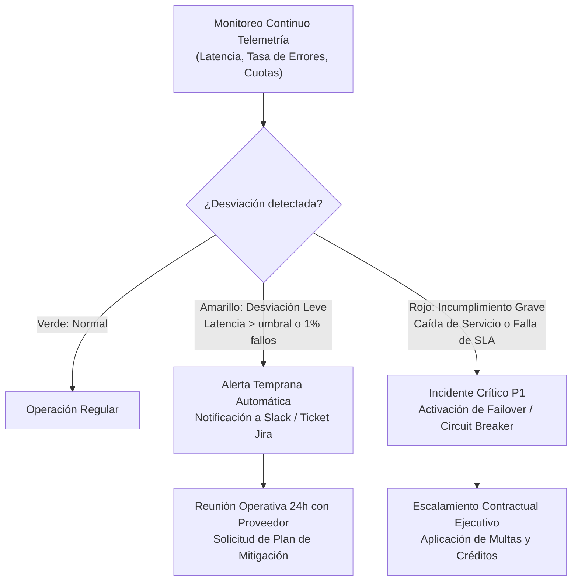

# ValVic — Marco de Gobernanza y Gestión de Proveedores Tecnológicos (SLA & Vendor Management)

> **Rol de Liderazgo:** Víctor Venegas Lindzay — Lead Project Leader & Solutions Architect  
> **Área:** PMO / Gestión de Proveedores / Operaciones TI / Cumplimiento Contractual  
> **Estándar:** ITIL v4 / DevOps / Contratos de Nivel de Servicio (SLA)  

---

## 1. Visión y Propósito del Marco de Gestión de Proveedores

En un ecosistema tecnológico moderno, más del 60% de los servicios de una plataforma dependen de proveedores externos (proveedores de nube, APIs de mensajería, modelos de inteligencia artificial y pasarelas de pago). 

El rol de un **Project Leader TI** no es confiar pasivamente en los proveedores, sino **gobernar su desempeño mediante métricas objetivas (SLAs/SLOs/SLIs), contratos de interfaz estrictos, monitoreo de alertas tempranas y planes de contingencia ante desviaciones contractuales**.

Este documento establece el marco con el que ValVic supervisa a sus proveedores tecnológicos críticos y cómo se gestionan reuniones operativas y tácticas con ellos.

---

## 2. Matriz de Proveedores Críticos y Niveles de Servicio (SLA)

| Proveedor | Servicio Prestado | Criticidad | SLA Contractual Mínimo | Métrica Clave (SLI) | Penalización / Acción de Alerta Temprana |
| :--- | :--- | :---: | :---: | :--- | :--- |
| **Meta Platforms Inc.** | Meta Cloud API (WhatsApp Business v25.0, Instagram Direct) | **CRÍTICA (Tier 1)** | 99.9% Uptime mensual | - Latencia de entrega de webhooks < 3.0s - Tasa de error HTTP 5xx < 0.1% | Conmutación automática a cola de reintentos (`sys_webhook_queue`); escalamiento a soporte Tier 2 de Meta for Developers si caída > 15 min. |
| **Oracle Cloud (OCI)** | Compute VM (Ampere A1) + Oracle Autonomous Database 23ai | **CRÍTICA (Tier 1)** | 99.95% Disponibilidad de DB | - Tiempo de respuesta de consulta SQL p95 < 25ms - Zero corrupción de almacenamiento NVMe | Failover automático a réplica local / alertas de uso de memoria en Prometheus/Grafana al superar el 85%. |
| **Google Cloud (Gemini API)** | Inferencia LLM Primaria (Gemini 2.5 Flash) | **ALTA (Tier 2)** | 99.5% Uptime | - Latencia Time-to-First-Token < 400ms - Tasa de error HTTP 429 (Rate Limit) < 0.5% | **Circuit Breaker:** Conmutación automática instantánea a Anthropic Claude (Fallback) si se detectan 3 fallos consecutivos en 30s. |
| **Anthropic PBC** | Inferencia LLM Secundaria / Respaldo (Claude 3.5 Sonnet) | **MEDIA (Tier 3)** | 99.0% Uptime | - Latencia total de inferencia < 2.5s | Monitoreo pasivo en reposo; activación exclusiva en eventos de conmutación. |
| **Clerk / Auth0** | Autenticación y Gestión de Identidades (CRM) | **ALTA (Tier 2)** | 99.9% Uptime | - Tiempo de validación de JWT < 15ms | Caché local de claves públicas JWKS para verificación offline sin llamar al endpoint de Clerk en cada request. |

---

## 3. Protocolo de Reuniones Tácticas y Operativas con Proveedores

Como Project Leader TI, la relación con proveedores de software y servicios de integración se estructura en dos niveles de gobernanza:

### 3.1 Comités Operativos Semanales (Stand-up con Proveedores de Desarrollo/Integración)
* **Periodicidad:** Semanal (30 minutos).
* **Participantes:** Project Leader TI (Víctor), Lead Engineer del Proveedor, QA Lead.
* **Agenda Estructurada:**
  1. **Revisión del Burndown Chart / Entregables del Sprint:** Comparar compromisos contractuales vs avance real en código.
  2. **Bloqueadores y Alertas Tempranas:** Identificación de cuellos de botella técnicos antes de que se conviertan en retrasos de fecha límite.
  3. **Calidad del Código y Definition of Done:** Revisión de cobertura de pruebas unitarias (mínimo 85%), vulnerabilidades detectadas en escaneos estáticos (SAST/Trivy) y cumplimiento de contratos OpenAPI.

### 3.2 Comités Tácticos Mensuales de Servicio (Vendor Review)
* **Periodicidad:** Mensual (60 minutos).
* **Participantes:** Project Leader TI, Gerente de Cuenta del Proveedor, Sponsor Interno.
* **Agenda Estructurada:**
  1. **Revisión del Reporte Ejecutivo de SLAs:** Análisis de caídas de servicio, latencias medias, disponibilidad real vs contratada.
  2. **Aplicación de Créditos de Servicio:** Si la disponibilidad cayó por debajo del 99.9%, exigir la compensación económica pactada en el contrato.
  3. **Revisión de Capacidad y Roadmap Tecnológico:** Planificar escalamiento de cuotas y evaluar nuevas versiones de APIs deprecadas.

---

## 4. Matriz de Alertas Tempranas y Gestión de Desviaciones Contractuales

### 4.1 Plan de Acción ante Desviaciones en Plazos de Proveedores de Software:
1. **Detección Temprana (Semana 1 del Sprint):** Si las User Stories en progreso muestran una velocidad 20% inferior a la proyectada, el Project Leader convoca una sesión de refinamiento técnico para desglosar o recortar alcance secundario.
2. **Defensa del Alcance Crítico:** Jamás se negocian hacia abajo los Criterios de Aceptación (Gherkin) ni la seguridad (multi-tenancy, cifrado). Se recortan características accesorias para mantener intacta la fecha de entrega de la fase central.
3. **Formalización de Incumplimiento:** Si el retraso se debe a incompetencia técnica del proveedor, se emite una notificación contractual formal requiriendo la asignación de recursos Senior adicionales a costo del proveedor.

---

## 5. Matriz RACI para la Gobernanza de Proyectos TI

| Actividad / Entregable | Project Leader TI (Víctor) | Sponsor de Negocio (BDO) | Proveedor Tecnológico | Usuario Final Interno |
| :--- | :---: | :---: | :---: | :---: |
| **Definición de Requerimientos y Backlog** | **Accountable (A)** | Consulted (C) | Informed (I) | Consulted (C) |
| **Aprobación de Contrato y SLAs de Proveedor** | Responsible (R) | **Accountable (A)** | Consulted (C) | Informed (I) |
| **Diseño de Arquitectura y Contratos API** | **Accountable (A)** | Informed (I) | Responsible (R) | Informed (I) |
| **Desarrollo y Construcción de Soluciones** | Consulted (C) | Informed (I) | **Responsible (R)** | Informed (I) |
| **Control de Calidad (QA) y Aceptación (UAT)** | **Accountable (A)** | Informed (I) | Responsible (R) | Responsible (R) |
| **Gestión del Cambio y Capacitación de Usuarios** | **Responsible (R)** | Consulted (C) | Informed (I) | Informed (I) |

---
*Este marco demuestra cómo un Project Leader TI ejerce control técnico soberano, garantizando que los proveedores cumplan con los estándares de calidad, seguridad y cronogramas comprometidos.*