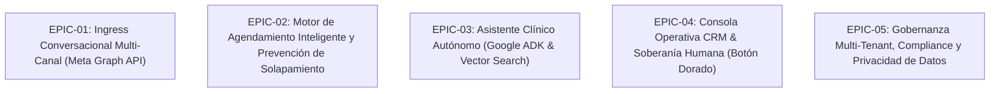

# ValVic — Product Backlog & Gobernanza Ágil (Scrum)

> **Rol de Liderazgo:** Víctor Venegas Lindzay — Certified Scrum Product Owner (SPOPC®) & Scrum Master (SMPC®)  
> **Estado:** Activo / Priorizado  
> **Metodología:** Scrum / Lean Kanban con Criterios de Aceptación Gherkin (Given-When-Then)  

---

## 1. Definición de Listo (Definition of Ready - DoR)

Una Historia de Usuario está lista para ingresar a un Sprint de desarrollo únicamente si cumple:
- [ ] **Valor de Negocio Claro:** Define claramente el *Quién*, el *Qué* y el *Para Qué*.
- [ ] **Criterios de Aceptación en Formato Gherkin:** Al menos un escenario positivo y uno de borde/excepción especificados en sintaxis `Dado-Cuando-Entonces`.
- [ ] **Contratos de Interfaz Definidos:** Endpoints OpenAPI, DDLs de base de datos o mocks de UI aprobados.
- [ ] **Evaluación de Riesgo de Seguridad y Privacidad:** Verificación de aislamiento multi-tenant (`tenant_id`).
- [ ] **Estimación de Esfuerzo:** Estimada en Puntos de Historia por el equipo de ingeniería.

---

## 2. Definición de Hecho (Definition of Done - DoD)

Una funcionalidad se considera terminada y lista para producción únicamente si cumple:
- [ ] **Código y Revisión de Pares:** Código implementado, tipado estricto (Pydantic / TypeScript) y PR aprobado sin comentarios bloqueantes.
- [ ] **Pruebas Automatizadas:** Tests unitarios y de integración pasando en CI/CD con cobertura mínima del **85%**.
- [ ] **Aislamiento Multi-Tenant Verificado:** Test explícito que comprueba que un tenant ajeno no puede acceder al recurso.
- [ ] **Documentación Técnica Actualizada:** Endpoint reflejado en OpenAPI / README y ADR generado si hubo decisión estructural.
- [ ] **Observabilidad y Logs:** Métricas de latencia y logs estructurados con `tenant_id` y `request_id` trazables.
- [ ] **Despliegue y Verificación en Staging:** Smoke tests ejecutados exitosamente en entorno pre-productivo.

---

## 3. Epics del Producto ValVic



---

## 4. Historias de Usuario Priorizadas (User Stories)

### US-01: Ingestión Asíncrona de Mensajes de WhatsApp sin Pérdida de Datos
* **Como:** Paciente que escribe a la clínica veterinaria por WhatsApp.  
* **Quiero:** Que mi mensaje sea recibido y procesado inmediatamente por el sistema.  
* **Para:** Recibir atención instantánea y no quedar esperando por caídas del servidor.

```gherkin
Escenario: Recepción exitosa de mensaje entrante de WhatsApp
  Dado que Meta envía un webhook POST a "/webhook/whatsapp" con firma HMAC válida
  Y el payload contiene un mensaje de texto de un paciente registrado
  Cuando la API de ValVic procesa la solicitud
  Entonces el endpoint responde HTTP 200 OK en menos de 20 milisegundos
  Y el mensaje se publica en la cola "queue:whatsapp:inbound" del broker Redis
  Y el socket HTTP con Meta se cierra inmediatamente.

Escenario: Rechazo de webhook con firma HMAC inválida (Intento de Spoofing)
  Dado que un atacante envía una petición POST a "/webhook/whatsapp"
  Y la cabecera "X-Hub-Signature-256" no coincide con el hash del payload
  Cuando el middleware de seguridad valida la petición
  Entonces el servidor responde HTTP 403 Forbidden
  Y el evento se registra como intento de intrusión en los logs de auditoría.
```

---

### US-02: Agendamiento Atómico de Citas Médicas sin Doble Reserva (Anti-Double-Booking)
* **Como:** Asistente conversacional de IA ("Val") o Secretaria de la Clínica.  
* **Quiero:** Bloquear un horario de atención médica de forma atómica en la base de datos.  
* **Para:** Garantizar que jamás se agenden dos pacientes en el mismo box a la misma hora.

```gherkin
Escenario: Reserva exitosa de slot de atención médica disponible
  Dado que el profesional "Dr. Soto" tiene disponible el slot de las "11:00 AM"
  Y el paciente cuenta con el hold temporal adquirido en Redis
  Cuando el paciente solicita confirmar su reserva para ese horario
  Entonces el sistema inserta la cita protegida por la restricción UNIQUE/EXCLUDE en la base de datos
  Y la cita queda formalizada con código único de reserva asignado al paciente
  Y el lock temporal en Redis se libera.

Escenario: Conflicto de concurrencia simultánea sobre el mismo horario
  Dado que dos pacientes intentan confirmar el mismo slot de las "11:00 AM" en el mismo milisegundo
  Cuando ambas solicitudes intentan insertar en la base de datos
  Entonces exactamente una inserción tiene éxito
  Y la segunda es rechazada por el motor relacional por violación de restricción única (IntegrityError)
  Y el asistente de IA le ofrece amablemente al segundo paciente el siguiente horario disponible ("11:30 AM").
```

---

### US-03: Activación del Cojín Humano ("Botón Dorado") en Caliente
* **Como:** Recepcionista u operador de la clínica en el CRM.  
* **Quiero:** Pausar la intervención de la IA en un chat específico con un solo clic.  
* **Para:** Tomar el control manual inmediato de una urgencia médica o un reclamo delicado sin interferencias del bot.

```gherkin
Escenario: Pausa instantánea de la IA por el operador humano
  Dado que un chat activo está siendo gestionado por el agente de IA
  Y el operador detecta que el paciente describe una urgencia respiratoria en su mascota
  Cuando el operador presiona el "Botón Dorado" en la interfaz del CRM
  Entonces la bandera "is_ai_paused" cambia a TRUE en la base de datos en menos de 50 ms
  Y cualquier mensaje subsiguiente del paciente es enrutado exclusivamente a la bandeja del operador humano
  Y el motor de IA cesa inmediatamente cualquier despacho automático a WhatsApp.

Escenario: Reanudación controlada de la IA tras resolución humana
  Dado que un chat activo tiene la bandera "is_ai_paused = TRUE"
  Y el operador humano ha resuelto y cerrado la consulta médica manual
  Cuando el operador reactiva el interruptor de asistencia de IA en el CRM
  Entonces la bandera "is_ai_paused" transiciona a FALSE
  Y el siguiente mensaje entrante del paciente vuelve a ser atendido autónomamente por "Val"
  Y se registra un evento de auditoría con la identidad del operador responsable.
```

---

### US-04: Aislamiento Multi-Tenant Estricto de Historiales Médicos
* **Como:** Administrador de la "Clínica Veterinaria SpotVet".  
* **Quiero:** Que mi personal sólo tenga acceso a las fichas clínicas de mis pacientes.  
* **Para:** Cumplir con la Ley de Protección de la Vida Privada y garantizar el secreto profesional.

```gherkin
Escenario: Consulta exitosa y legítima de paciente dentro del mismo tenant
  Dado que un usuario está autenticado en el CRM con "tenant_id = clinic_spotvet"
  Cuando el cliente envía una petición GET a "/api/pacientes/PAC-1001"
  Y el paciente "PAC-1001" pertenece a "tenant_id = clinic_spotvet"
  Entonces el backend responde HTTP 200 OK con la ficha clínica completa
  Y se valida criptográficamente que no hubo fugas de datos hacia otros tenants.

Escenario: Intento de acceso transversal a datos de otra clínica
  Dado que un usuario está autenticado en el CRM con "tenant_id = clinic_spotvet"
  Cuando el cliente envía una petición GET a "/api/pacientes/PAC-9988"
  Y el paciente "PAC-9988" pertenece a "tenant_id = clinic_conzoolvet"
  Entonces el backend responde HTTP 404 Not Found
  Y no se revela ninguna información sobre la existencia de dicho paciente
  Y se registra una alerta de seguridad por intento de violación de límites de tenant.
```