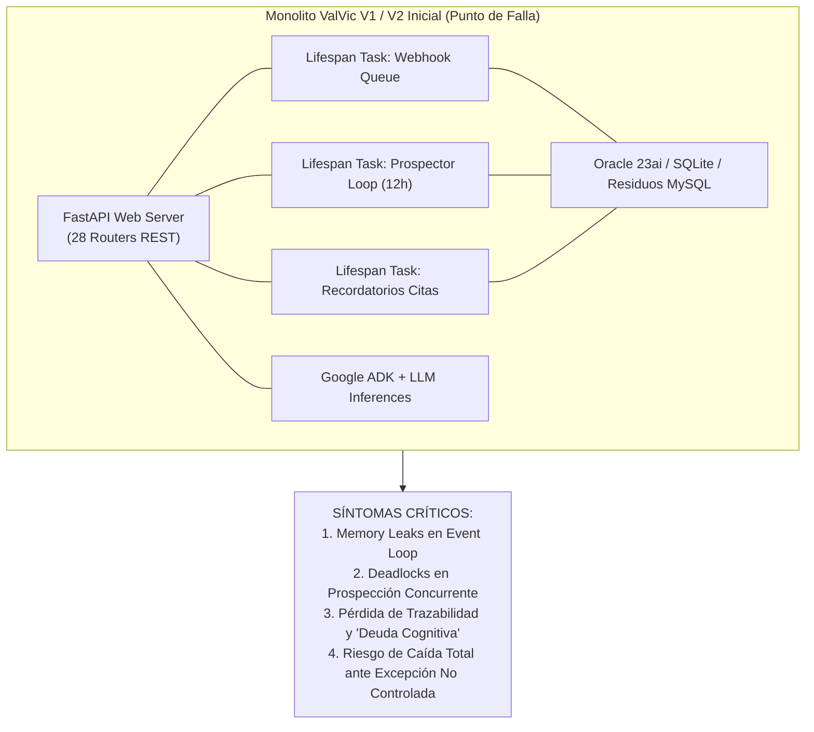

# ValVic — Post-Mortem de Ingeniería: El Colapso del Monolito y la Auditoría de Deuda Técnica

> **Código:** PM-0001  
> **Estado:** Aprobado / Lección Aprendida  
> **Fecha:** Mayo 2026 (Consolidado: Noviembre 2026)  
> **Autor:** Víctor Venegas Lindzay — Founder & Technical Product Manager  
> **Impacto Arquitectónico:** Crítico (Pivote hacia "Documentation-First" y Arquitectura Desacoplada)

---

## 1. Resumen Ejecutivo (Executive Summary)

ValVic nació como una plataforma SaaS multi-tenant orientada a resolver la pérdida de oportunidades comerciales y el agendamiento médico para clínicas veterinarias y centros de salud en Chile mediante la automatización por WhatsApp e Inteligencia Artificial.

Durante las primeras fases de desarrollo (V1 y primera iteración de V2), el proyecto experimentó un crecimiento acelerado de funcionalidades impulsado por herramientas de generación asistida por IA. Aunque se logró construir una cantidad masiva de componentes operativos (28 routers en FastAPI, 44 tablas en base de datos, CRM en Next.js 15, integración con Meta Graph API v25.0 y agentes Google ADK), **el sistema alcanzó un punto de saturación y colapso de mantenibilidad**.

El monolito se volvió inviable debido a tres factores concurrentes:
1. **Acoplamiento extremo de ciclo de vida (In-Process Lifespan Coupling):** Tareas de fondo pesadas (prospección, barrido de leads, colas de webhooks) compartían el mismo proceso y *event loop* que la API web.
2. **Deuda de migración y dispersión de datos:** Convivencia caótica de esquemas históricos (MySQL, PostgreSQL, SQLite, Oracle 23ai) con scripts manuales de rescate (`fix_all_tests.py`, `convert_tests.py`).
3. **Deuda Cognitiva e Inversión del Orden de Ingeniería:** Se escribió código antes de definir formalmente los contratos de interfaz (OpenAPI), los invariantes de dominio y los límites de contexto (*Bounded Contexts*).

Este post-mortem analiza con rigor técnico las causas raíz del colapso, documenta las decisiones de mitigación y establece la justificación del por qué **la documentación arquitectónica rigurosa es el único cimiento viable antes de tirar una sola línea de código**.

---

## 2. Anatomía del Monolito: Cronología y Síntomas de Falla

### 2.1 Síntoma 1: El Acoplamiento de Tareas en Segundo Plano (FastAPI Lifespan)
En lugar de contar con un broker de mensajería independiente (como RabbitMQ o Redis) y workers dedicados (Celery o contenedores desacoplados), se introdujeron tareas en segundo plano dentro del `lifespan` de FastAPI en `main.py`:
- `webhook_queue_worker`: Procesaba mensajes de WhatsApp entrantes.
- `prospector_scheduler`: Ejecutaba scraping y generación de copy B2B cada 12 horas.
- `reminder_scheduler`: Despachaba avisos de citas.

**Mecanismo de Falla:**
Cuando el prospector consumía cuotas pesadas de red o experimentaba bloqueos en scraping, o cuando las llamadas a la API de LLMs (Gemini/Claude) sufrían retardos por alta latencia, el bucle de eventos (`asyncio`) de FastAPI sufría micro-bloqueos. Esto degradaba el tiempo de respuesta de la API pública ante los webhooks de Meta, rozando el umbral de 3 segundos permitido por Meta antes de disparar reintentos en cascada.

### 2.2 Síntoma 2: Dispersión y Residuos de Base de Datos
El proyecto pasó por múltiples tecnologías de persistencia en su afán de optimización:
- Comenzó en MySQL.
- Intentó migrar a PostgreSQL.
- Se reestructuró hacia Oracle Database 23ai (para aprovechar Vector AI Search nativo en la capa gratuita de OCI) con emulación local en SQLite.

**Mecanismo de Falla:**
Aunque el código de la API finalmente operaba bajo SQLModel, el repositorio quedó contaminado con más de 10 archivos `.sql` sueltos en `backend/database/`, dependencias incompatibles (`aiomysql`, `PyMySQL`) en `requirements.txt`, y scripts de emergencia como `fix_all_tests_v3.py`. Cada cambio en un modelo requería verificar manualmente si rompía SQLite en local o los 24 DDLs de Oracle en producción.

### 2.3 Síntoma 3: La Trampa de la "Deuda Cognitiva" Asistida por IA
El uso extensivo de modelos de lenguaje para autogenerar endpoints, modelos y componentes aceleró la producción de artefactos de software, pero **generó una brecha entre la complejidad del código generado y el modelo mental del desarrollador**.
- Se construyeron 28 routers sin contratos de interfaz congelados.
- Cada vez que fallaba un test, la tentación inmediata era "pedirle a la IA otro script que parcheara el test" (`fix_all_tests.py`), en lugar de auditar el invariante de dominio subyacente.
- El costo de mantener y depurar el sistema escaló exponencialmente.

---

## 3. Análisis de Causa Raíz (Root Cause Analysis - 5 Whys)

| Nivel | Pregunta | Causa Raíz Técnica |
| :---: | :--- | :--- |
| **1** | ¿Por qué el backend de ValVic se volvió insostenible? | Porque modificar un módulo (ej. agenda o prospección) generaba regresiones inesperadas en chats y webhooks. |
| **2** | ¿Por qué había regresiones cruzadas entre módulos? | Porque todos los routers y tareas compartían el mismo proceso de ejecución, estado en memoria y modelos de datos sin aislamiento. |
| **3** | ¿Por qué se colocaron las tareas de fondo dentro del proceso web? | Para no incurrir en costos de servidores adicionales y evitar configurar infraestructura externa como Redis o Celery en OCI Always Free. |
| **4** | ¿Por qué no se anticipó el impacto de acoplar workers en el proceso web? | Porque se priorizó la velocidad de entrega de funcionalidades sobre el diseño formal de la arquitectura y la evaluación de riesgos operacionales. |
| **5** | ¿Por qué se priorizó la velocidad sobre el diseño arquitectónico? | **Causa Raíz Fundamental:** Porque se operó en modo *Code-First* asistido por IA, en lugar de adoptar un enfoque *Documentation-First* con Documentos de Arquitectura (SAD), Registro de Decisiones (ADR) y Criterios de Aceptación verificables. |

---

## 4. Matriz de Deuda Técnica Auditada

| Componente | Nivel de Riesgo | Deuda Técnica Identificada | Impacto Operativo | Solución Arquitectónica Definitiva |
| :--- | :---: | :--- | :--- | :--- |
| **Ingress Webhooks** | **ALTO** | Meta exige respuesta `<3s`. Si el worker encola sincrónicamente o bloquea la DB, Meta bloquea el webhook. | Caída del canal WhatsApp comercial. | Ingress Gateway Stateless sub-20ms con broker de mensajería estándar (Redis) y flotas de workers desacopladas (ADR-0001). |
| **Worker Prospección** | **CRÍTICO** | Bucle de 12 horas ejecutándose en memoria dentro de FastAPI sin candado distribuido. Si se escalaba a 2 réplicas, enviaba mensajes duplicados. | Spam masivo a prospectos, riesgo de ban de número telefónico en WhatsApp Business. | Extraer a un proceso worker independiente (CLI/Cron en Docker separado) gobernado por un job lock en broker/DB. |
| **Esquemas de Datos** | **MEDIO** | Residuos de MySQL y la trampa del motor dual SQLite (falsos positivos de tests). | Confusión en migraciones y riesgo de deploy de esquemas obsoletos. | Purga total de archivos legacy. Adopción del Factor X de Twelve-Factor App: Paridad Dev/Prod estricta usando contenedores Docker con el motor idéntico en local, CI y prod (ADR-0002). |
| **Límites de Dominio** | **ALTO** | 28 routers conviviendo en una sola carpeta `api/routers/` sin delimitación de *Bounded Contexts*. | Imposibilidad de asignar módulos a proveedores o desarrolladores independientes sin colisiones de Git. | Reorganización en 4 Bounded Contexts: *Core Conversational*, *CRM Management*, *Prospector Engine*, *Client Sites*. |

---

## 5. El Pivote Metodológico: Deuda Técnica como Escuela de Liderazgo

El reconocimiento explícito de este fracaso monolítico fue el punto de inflexión profesional del autor. Demostró empíricamente los principios de la ingeniería de software clásica:

> *"La velocidad inicial que otorga el código sin documentación es una ilusión contable: cada hora ahorrada en diseño previo se paga multiplicada por diez en depuración, ansiedad técnica y fragilidad operacional."*

### Lecciones Transferibles al Rol de **Project Leader TI**:
1. **Gobernanza de Proveedores con Especificación Previa:** Un proveedor externo construirá un monolito inmanejable si no se le exige de antemano un contrato OpenAPI estricto, una batería de pruebas de integración con cobertura mínima (ej. 85%) y una separación rigurosa de responsabilidades.
2. **Definición de Hecho (Definition of Done - DoD):** Una funcionalidad no está terminada cuando "compila y pasa un test local", sino cuando cuenta con su ADR correspondiente, documentación técnica para soporte y observabilidad estructurada.
3. **Gestión del Riesgo en IA (AIRMPC):** La IA generativa es un multiplicador de fuerza extraordinario para acelerar tareas repetitivas, pero jamás debe reemplazar el juicio arquitectónico, el modelado formal ni el entendimiento de los primeros principios de la computación.

---

## 6. Conclusiones y Compromiso de Refundación

ValVic no requería ser desechado en su valor de negocio ni en su visión de mercado; requería ser **refundado bajo el estándar de excelencia de ingeniería desarrollado en StockPilot**:
1. La arquitectura se documenta antes de codificar (SAD).
2. Cada dilema técnico de diseño se congela en un ADR formal con pros, contras y consecuencias.
3. Las leyes de negocio se definen como invariantes matemáticas inviolables.
4. Las historias de usuario se escriben en lenguaje Gherkin para que negocio y tecnología compartan exactamente la misma expectativa.

Esta transición es el testimonio vivo de madurez técnica que define a un líder de proyectos.