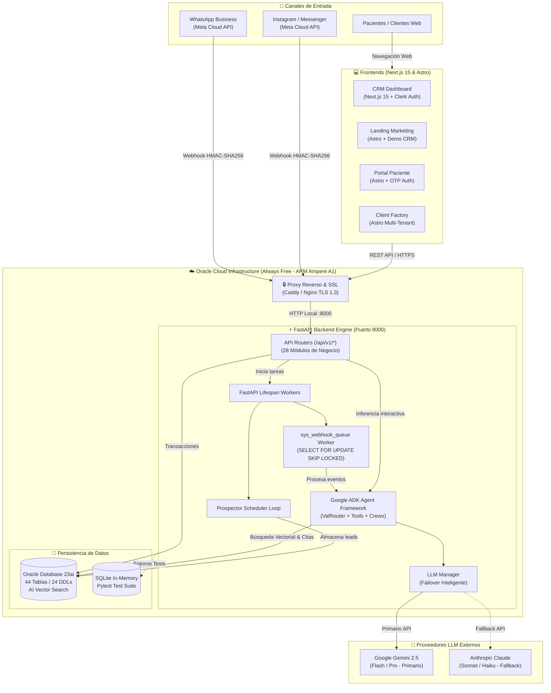
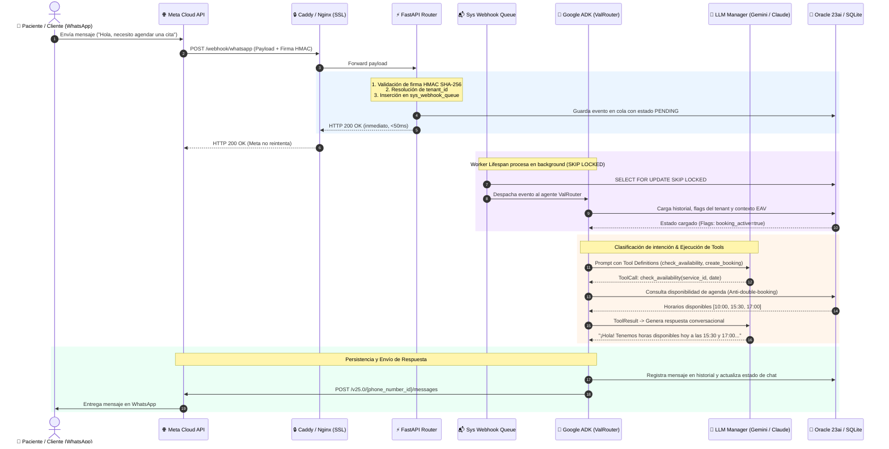
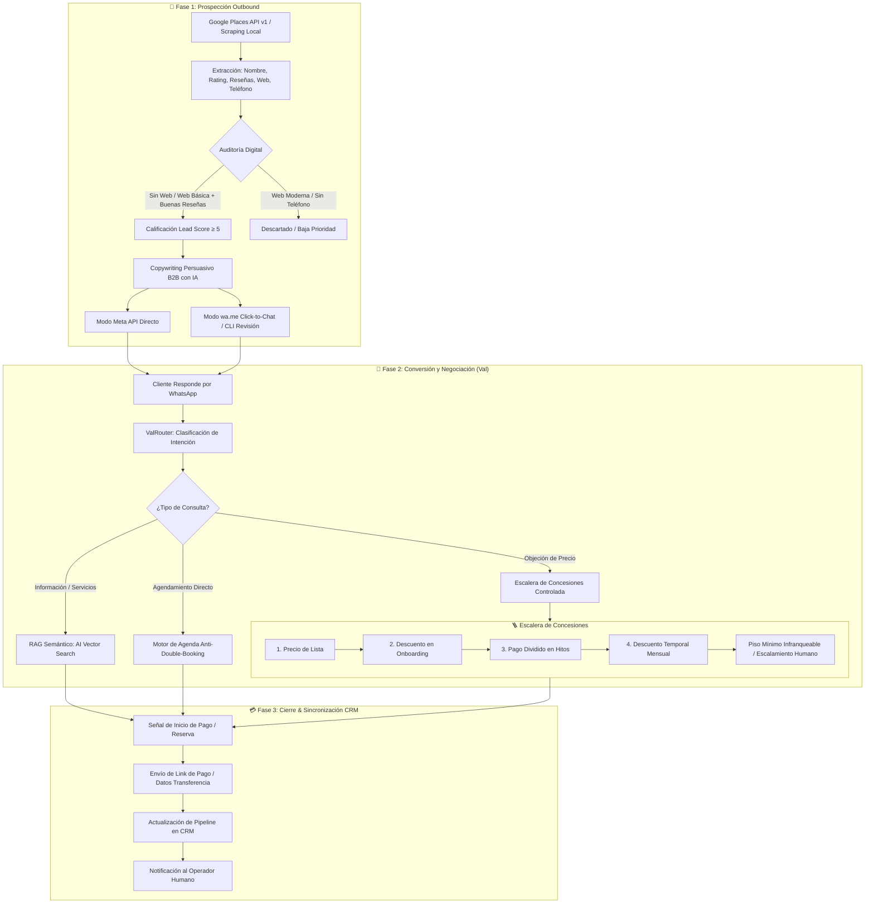
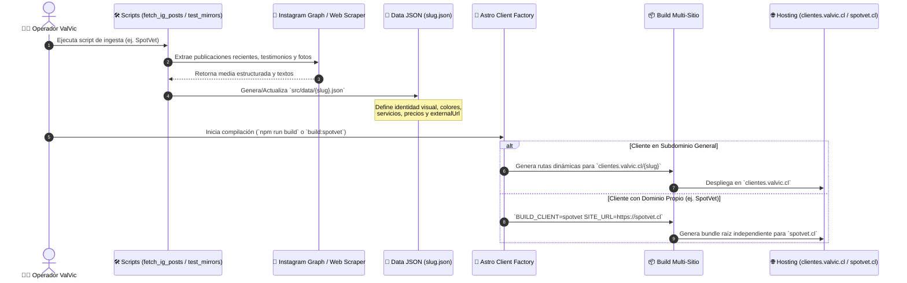
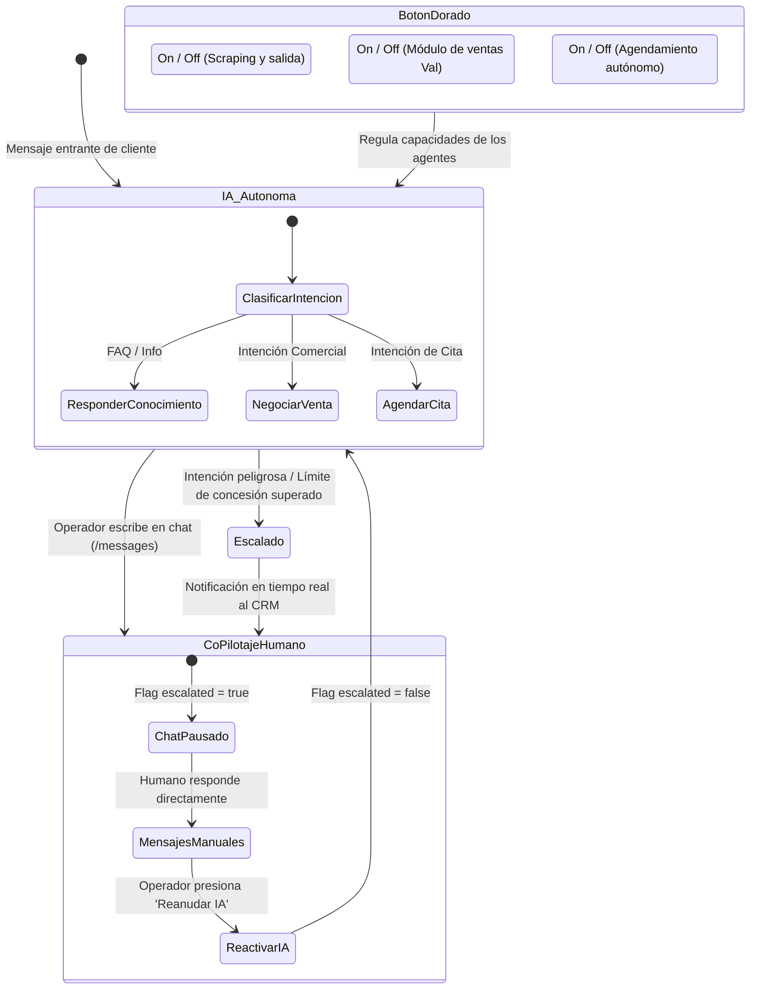
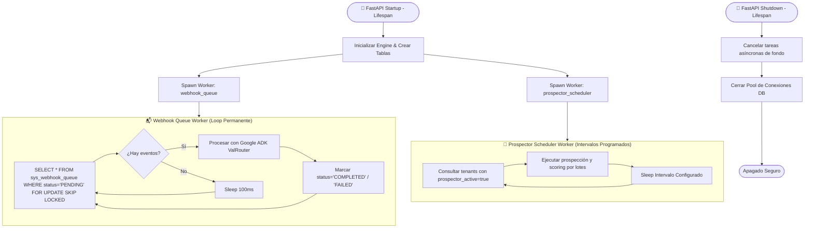

# ValVic — Colección de Diagramas de Arquitectura y Flujos del Sistema

> **Guía Visual y Técnica para Presentaciones, Evaluaciones de Arquitectura y Onboarding.**  
> *Versión 2.0 — Ecosistema Multi-Tenant de Automatización Conversacional e IA.*

---

## Índice de Diagramas

1. [Arquitectura Global de Componentes (C4 Nivel 2)](#1-arquitectura-global-de-componentes-c4-nivel-2)
2. [Flujo End-to-End de Mensajería WhatsApp & Orquestación IA](#2-flujo-end-to-end-de-mensajería-whatsapp--orquestación-ia)
3. [Embudo Comercial Autónomo (Outbound + Inbound + Cierre)](#3-embudo-comercial-autónomo-outbound--inbound--cierre)
4. [Dual Database Engine y Aislamiento Multi-Tenant](#4-dual-database-engine-y-aislamiento-multi-tenant)
5. [Client Factory — Pipeline de Generación de Sitios Web](#5-client-factory--pipeline-de-generación-de-sitios-web)
6. [CRM Multitenant, Co-pilotaje Humano y Botón Dorado](#6-crm-multitenant-co-pilotaje-humano-y-botón-dorado)
7. [Ciclo de Vida de Workers Asíncronos (FastAPI Lifespan)](#7-ciclo-de-vida-de-workers-asíncronos-fastapi-lifespan)

---

## 1. Arquitectura Global de Componentes (C4 Nivel 2)

Este diagrama representa cómo interactúan las aplicaciones del frontend, la API backend, los servicios externos de IA y mensajería, y el motor de persistencia en Oracle Cloud Infrastructure (OCI).

---

## 2. Flujo End-to-End de Mensajería WhatsApp & Orquestación IA

El patrón de desacoplamiento asíncrono garantiza que el webhook de Meta reciba una respuesta HTTP `200 OK` en menos de 100 ms, mientras la IA orquesta la respuesta en segundo plano sin riesgo de timeout.

---

## 3. Embudo Comercial Autónomo (Outbound + Inbound + Cierre)

ValVic automatiza el ciclo comercial B2B completo, permitiendo captar clínicas en frío mediante prospección geolocalizada y cerrar ventas o agendamientos mediante el agente Val.

---

## 4. Dual Database Engine y Aislamiento Multi-Tenant

Arquitectura de persistencia basada en **SQLModel (100% ORM, 0 SQL crudo)** con detección automática de motor en `engine.py`.

```mermaid
flowchart LR
    subgraph AppLayer["Capas de Aplicación"]
        FastAPI_App["FastAPI Routers & Services"]
        ADK_Agents["Google ADK Agents & Tools"]
        Cron_Workers["Lifespan / Scheduled Workers"]
    end

    subgraph ORMLayer["Capa ORM Unificada (SQLModel)"]
        SQLModel_Core["44 Modelos SQLModel<br/>(13 Archivos de Dominio)"]
        Singleton["_build_engine() Singleton"]
    end

    subgraph EngineResolution["Resolución de Motor en Tiempo de Ejecución"]
        CheckEnv{"¿Entorno?"}
        CheckEnv -->|Pytest o VALVIC_ENV=local| SQLiteEngine["SQLite Engine<br/>(valvic_dev.db / Memory)"]
        CheckEnv -->|ORACLE_DSN + PASSWORD| OracleEngine["Oracle 23ai Engine<br/>(Pool Size: 4, Max Overflow: 8)"]
    end

    subgraph MultiTenantSecurity["Aislamiento Multi-Tenant Obligatorio"]
        TenantFilter["Cláusula Determinista:<br/><code>WHERE tenant_id = :current_tenant_id</code>"]
        Checkpoints["Google ADK Checkpoints & Escalations"]
        Vectors["Oracle AI Vector Search Embeddings"]
    end

    AppLayer --> SQLModel_Core
    SQLModel_Core --> Singleton
    Singleton --> CheckEnv
    SQLiteEngine --> MultiTenantSecurity
    OracleEngine --> MultiTenantSecurity
```

---

## 5. Client Factory — Pipeline de Generación de Sitios Web

El módulo **Client Factory** automatiza la creación de páginas web para clínicas veterinarias y pymes asociadas, integrando scraping inteligente y mirrors de Instagram.

---

## 6. CRM Multitenant, Co-pilotaje Humano y Botón Dorado

El CRM en **Next.js 15** permite supervisar todas las conversaciones en vivo, pausar la IA en caliente (cojín humano) y controlar los flags de automatización mediante el **Botón Dorado**.

---

## 7. Ciclo de Vida de Workers Asíncronos (FastAPI Lifespan)

A diferencia de arquitecturas tradicionales que requieren crontabs externos fragmentados, ValVic implementa workers residentes en el ciclo de vida de FastAPI (`lifespan`), simplificando el despliegue a un solo contenedor o proceso.

