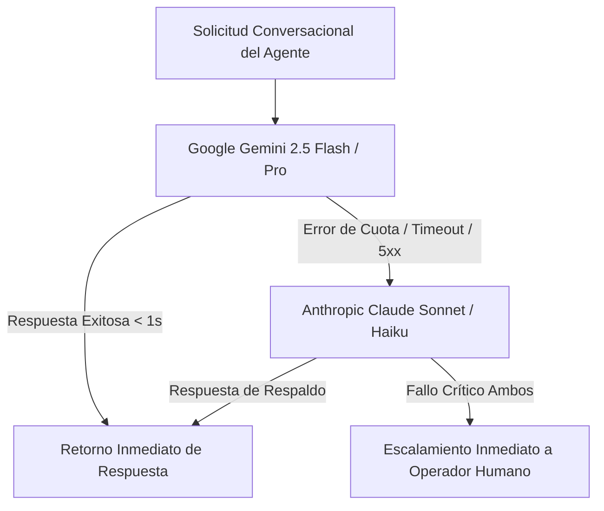

# Especificación de Arquitectura de Sistemas

> **Topología de Infraestructura, Seguridad Perimetral y Persistencia Multi-Tenant.**  
> *Versión 2.0 — ValVic SaaS Platform.*

---

## 1. Topología de Infraestructura (OCI Always Free + Cloud Native)

El backend y la capa de datos de ValVic operan bajo la capa de servicios **Always Free** de **Oracle Cloud Infrastructure (OCI)**, optimizando los costos fijos a **$0 USD/mes** con rendimiento y tolerancia a fallos de nivel empresarial.

```
                    [ Tráfico HTTPS (Puertos 80 / 443) ]
                                   │
                                   ▼
                      [ OCI VCN Security List ]
                                   │
                                   ▼
                    [ VM Compute ARM Ampere A1 ]
            ┌──────────────────────────────────────────────┐
            │         Ubuntu Server 22.04 (aarch64)        │
            │                                              │
            │   [ Caddy / Nginx SSL (Let's Encrypt TLS) ]  │
            │                      │                       │
            │                (Proxy Local)                 │
            │                      ▼                       │
            │        [ FastAPI Engine (Port 8000) ]        │
            │        ├─ Lifespan: Webhook Queue Worker     │
            │        ├─ Lifespan: Prospector Scheduler     │
            │        └─ Google ADK ValRouter Engine        │
            │               │              │               │
            │        (SQLModel ORM)    (HTTPS TLS 1.3)     │
            │               │              │               │
            └───────────────┼──────────────┼───────────────┘
                            │              │
                            ▼              ▼
              [ Oracle Database 23ai ]   [ Google Gemini 2.5 ]
              (44 Tablas / Vector AI)    (Primario / Flash & Pro)
                            │              │
                            ▼              ▼
                   [ Oracle Object ]     [ Anthropic Claude ]
                   [    Storage    ]     (Fallback Híbrido)
```

### Componentes Físicos y Lógicos de la Instancia:
1. **VM Compute Ampere A1 (ARM64):**
   * **Especificaciones:** 4 OCPUs ARM Ampere, 24 GB de memoria RAM y 200 GB de almacenamiento NVMe en bloque.
   * **Sistema Operativo:** Ubuntu Server 22.04 LTS optimizado para arquitecturas `aarch64`.
2. **Servidor Web y Proxy Reverso (Caddy / Nginx):**
   * Gestiona certificados TLS 1.3 automáticos vía Let's Encrypt para `api.valvic.cl` y subdominios.
   * Redirige tráfico HTTPS al puerto `8000` donde corre Uvicorn.
   * Aplica compresión Gzip/Brotli y headers de seguridad HTTP (`HSTS`, `X-Content-Type-Options`, `X-Frame-Options`).
3. **Servicio FastAPI (`valvic-api.service`):**
   * Demonio administrado por `systemd` que ejecuta la API web con `uvicorn`. Se configura con reinicio automático (`Restart=always`).
   * **Lifespan Workers Integrados:** Los trabajadores de cola (`webhook_queue`) y el despachador de prospección (`prospector_scheduler`) corren en el mismo loop de eventos de `asyncio`, eliminando la necesidad de brokers pesados como Redis o RabbitMQ.

---

## 2. Persistencia y Motor de Datos Dual (SQLModel)

La capa de persistencia está construida en **SQLModel (100% ORM)**, eliminando sentencias SQL crudas y ofreciendo portabilidad transparente entre entornos.

```
                    ┌─────────────────────────┐
                    │     SQLModel Models     │
                    │   (44 Tablas / Core)    │
                    └────────────┬────────────┘
                                 │
                     [_build_engine() Singleton]
                                 │
                  ┌──────────────┴──────────────┐
                  ▼                             ▼
       [ Entorno Desarrollo / CI ]    [ Entorno Producción OCI ]
             SQLite Local                Oracle Database 23ai
          (valvic_dev.db)                (Pool size: 4, Max: 8)
       - Tests Pytest inmediatos      - Persistencia Relacional
       - Schemas automáticos          - Oracle AI Vector Search
       - Cero dependencias cloud      - Checkpoints de Agentes
```

* **Oracle Database 23ai (Producción):**
  * **24 Archivos DDL Secuenciales:** Migraciones ordenadas que cubren catálogos, tenants, citas, oportunidades, analytics, EAV de pacientes, base de conocimiento y auditoría.
  * **AI Vector Search:** Búsqueda semántica de embeddings vectoriales dentro de la misma base relacional en la tabla `knowledge_base`, optimizando la latencia de RAG clínico a milisegundos.
  * **Google ADK Checkpoints:** Almacena estados conversacionales y variables de sesión de forma transaccional.
* **SQLite (Desarrollo y CI):**
  * Detección automática en `engine.py` si se ejecutan pruebas (`"pytest" in sys.modules`) o si `VALVIC_ENV=local`.
  * Creación dinámica de esquema mediante `SQLModel.metadata.create_all()`.

---

## 3. Seguridad Perimetral, Cifrado y Compliance

La seguridad se implementa de forma defensiva en todas las capas de transporte, aplicación y datos:

### A. Validación Criptográfica en la Frontera (Ingress)
* **Meta HMAC-SHA256 Signature:** Cada petición enviada por Meta Cloud API a `/webhook/whatsapp` o `/webhook/messenger` incluye el header `X-Hub-Signature-256`. El servidor computa el hash HMAC con `META_APP_SECRET` sobre el payload bruto. Si no coincide exactamente, la petición es rechazada de inmediato (`403 Forbidden`).
* **Firewall Perimetral:**
  * **OCI Security List:** Solo se exponen externamente los puertos `80` (HTTP redirección) y `443` (HTTPS seguro).
  * **UFW Local:** El puerto `8000` de FastAPI solo escucha en `127.0.0.1` (localhost), impidiendo accesos directos no autenticados.

### B. Aislamiento Multi-Tenant Estricto
* **Inyección Determinista de Tenant:** Toda consulta a las 44 tablas operacionales incluye obligatoriamente el filtro `WHERE tenant_id = :tenant_id`, resuelto desde el token JWT autenticado en Clerk o desde el identificador de teléfono en webhooks entrantes.
* **Regla de Oro:** Ninguna consulta puede cruzar datos de dos tenants diferentes bajo ninguna circunstancia.

### C. Compliance y Privacidad (GDPR & Meta Data Deletion)
* **Endpoints de Cumplimiento:** Implementación de endpoints certificados para solicitud de borrado de datos de usuario (`POST /compliance/data-deletion`) y consulta de estado de borrado (`GET /compliance/data-deletion/status/{confirmation_code}`).

---

## 4. Orquestación Resiliente de Inteligencia Artificial (LLM Manager)

Para garantizar un 99.9% de disponibilidad en la atención conversacional, ValVic implementa una cadena de **failover híbrido multi-proveedor**:



* **Control de Tokens y Latencia:** Registro granular de tokens consumidos (prompt + completion) y tiempo de respuesta en milisegundos en la tabla `sys_usage_tracking`.
* **Protección de Credenciales:** Claves de API (`GOOGLE_AI_API_KEY`, `ANTHROPIC_API_KEY`, `META_APP_SECRET`) inyectadas exclusivamente en variables de entorno de producción, excluidas de repositorios públicos.
